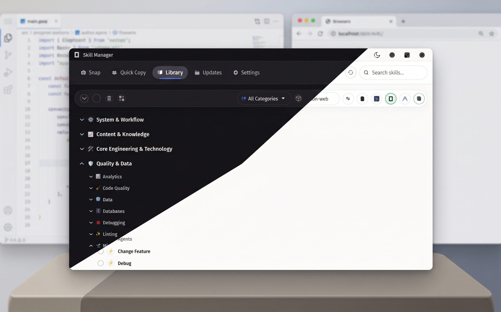
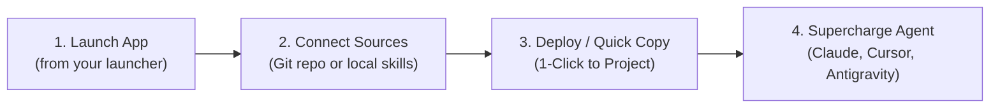
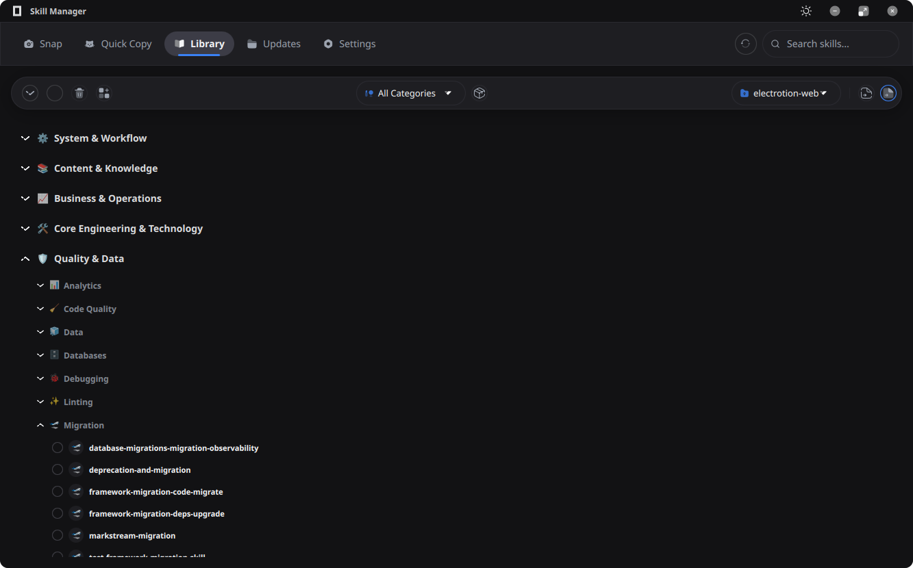
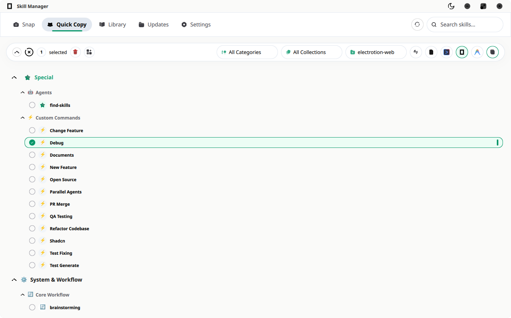
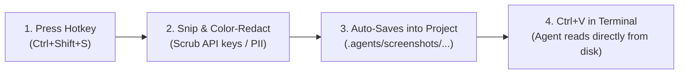
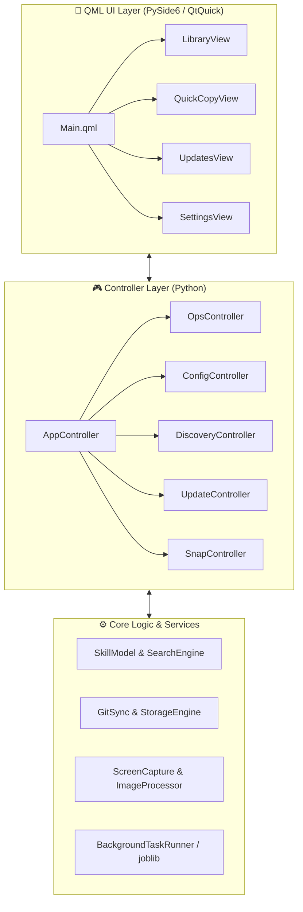

<div align="center">
  
  <h1>SkillManager</h1>
  <p><strong>The desktop command center for organizing, syncing, and deploying AI agent skills across your repositories.</strong></p>
</div>

---

## 📺 See It In Action (Demo)

<!-- TODO(readme): the demo video asset below returns HTTP 404 (verified
     2026-10-18), so the page rendered a dead embed. The original markup is kept
     verbatim here — re-upload the overview video, update the src, and move the
     block back out of this comment.

<div align="center">
  <video src="https://github.com/user-attachments/assets/29541600-3647-474d-8a3e-98160cdd37ff" controls="controls" muted="muted" width="100%" style="max-height: 640px; border-radius: 12px; box-shadow: 0 8px 24px rgba(0,0,0,0.2);"></video>
  <p><em>Watch the overview of SkillManager in action.</em></p>
</div>
-->

<p align="center">
  
</p>

---

## 🧭 Feature Index

| Capability | What it gives you |
| --- | --- |
| **[Central Library & Inspector](#central-library--inspector)** | Search, filter, inspect, star, archive, and deploy thousands of skills from one place. |
| **[Quick Copy & Format Switcher](#quick-copy--format-switcher)** | Copy references in your agent's exact syntax, with project cycling and automatic dependency carry. |
| **[Surgical Git Synchronization](#surgical-git-synchronization)** | See exactly which skills are stale in which repository, then sync only those. |
| **[Snap to Project](#snap-to-project-instant-visual-context-for-tui--terminal-agents)** | Hotkey capture, color-redact PII, save into the active project, paste into your terminal. |
| **[Updates & Automatic Sync](#updates--automatic-sync)** | Track skill packages, install updates in the background, and hear about new SkillManager releases. |
| **[MCP Automation Bridge](#mcp-automation-bridge)** | Drive the library, screenshots, and UI inspection from an AI agent over stdio MCP. |
| **[Accessibility & Comfort](#accessibility--comfort)** | Screen-reader semantics, full keyboard operation, reduced motion, compact rows, and themes. |

---

## 💡 Why SkillManager?

Modern AI coding agents (**Claude Code**, **Antigravity**, **Cursor**, **Gemini CLI**, **OpenCode**, **Codex**) are only as capable as the specialized skills, commands, and prompts you give them.

However, managing agent skills and multimodal context across multiple project repositories quickly becomes fragmented and painful:

| The Problem (Without SkillManager)                                                                                                                                                 | The Solution (With SkillManager)                                                                                                                                                                                                   |
| ---------------------------------------------------------------------------------------------------------------------------------------------------------------------------------- | ---------------------------------------------------------------------------------------------------------------------------------------------------------------------------------------------------------------------------------- |
| ❌**Skill Drift:** Improved prompts in one repo stay trapped there; other repos run stale skills.                                                                            | ✅**Central Library & Surgical Sync:** One unified source of truth. Updates propagate across repos in milliseconds.                                                                                                          |
| ❌**Package Drift:** GitHub, NPX, and script-based skill packs go stale silently, and checking each one by hand doesn't scale.                                               | ✅**Background Updates:** Version checks run at startup and every 6 hours, install in the background, and a toast tells you when a new SkillManager release is out.                                                              |
| ❌**Manual Copy-Paste Overhead:** Manually copying `.agents/skills/` folders and forgetting required dependencies.                                                         | ✅**1-Click Multi-Deploy:** Deploy single skills, custom collections, or `.md` commands to multiple projects simultaneously.                                                                                               |
| ❌**Context Switching:** Digging through nested directories to find the exact skill reference syntax for your current IDE.                                                   | ✅**Quick Copy Companion:** Copy ready-to-paste references formatted for your active agent in a click (`Ctrl+C` on a focused skill, or the **Copy Reference** button).                                                                                              |
| ❌**Clumsy Multimodal Context for Terminal Agents:** Taking a screenshot, saving to Desktop, moving it into the repo, finding the path, and hoping no API keys were exposed. | ✅**Snap to Project & PII Redaction:** Hotkey snips, color-redacts sensitive tokens, auto-saves directly to `<project>/.agents/screenshots/`, and copies a client-formatted reference for instant `Ctrl+V` into your TUI/CLI agent. |

---

## 🚀 1-Command Installation & Updates

No repository cloning, virtual environment setup, or build toolchains required. Get started immediately:

> Every downloaded artifact is verified against the release's `SHA256SUMS` manifest before installation.

### 🐧 Ubuntu / Debian (Recommended)

```bash
# Install / Upgrade to latest version
curl -fsSL https://raw.githubusercontent.com/dishanagalawatta/SkillManager/main/scripts/install.sh | bash

# Check & Apply Updates anytime
curl -fsSL https://raw.githubusercontent.com/dishanagalawatta/SkillManager/main/scripts/install.sh | bash -s -- --update

# Clean Uninstall (--purge removes settings and cache)
curl -fsSL https://raw.githubusercontent.com/dishanagalawatta/SkillManager/main/scripts/install.sh | bash -s -- --uninstall
```

### 📦 Other Linux Distros (Portable AppImage)

```bash
# Install / Upgrade portable AppImage
curl -fsSL https://raw.githubusercontent.com/dishanagalawatta/SkillManager/main/scripts/install.sh | bash -s -- --appimage

# Uninstall
curl -fsSL https://raw.githubusercontent.com/dishanagalawatta/SkillManager/main/scripts/install.sh | bash -s -- --uninstall
```

### 🪟 Windows (Setup.exe)

Download `SkillManager_Setup.exe` from [GitHub Releases](https://github.com/dishanagalawatta/SkillManager/releases), verify it against the release's `SHA256SUMS`, then run it (if SmartScreen appears, click **More info** → **Run anyway**).

<!-- TODO(readme): winget is NOT published, so the commands below fail with
     "No package found matching input criteria". Submission
     microsoft/winget-pkgs#391299 (dishanagalawatta.SkillManager v1.8.0,
     opened 2026-06-21) was closed UNMERGED as "Stale" by a maintainer on
     2026-07-21, and `manifests/d/dishanagalawatta` is absent from
     microsoft/winget-pkgs (verified 2026-10-18). The in-repo manifests under
     packaging/winget/manifests/ stop at 1.8.0. Re-submit an up-to-date
     manifest, then move this block back out of the comment.

```powershell
# Install via Windows Package Manager (Verified, No SmartScreen warning)
winget install --id dishanagalawatta.SkillManager -e --source winget

# Upgrade
winget upgrade --id dishanagalawatta.SkillManager

# Uninstall
winget uninstall --id dishanagalawatta.SkillManager
```
-->

---

## ⏱️ Quick Start: Your First 60 Seconds

Get productive in 4 straightforward steps:



1. **Launch SkillManager**: Open the app from your application launcher. (Note: the global hotkey `Ctrl+Shift+S` does not launch the app — it captures a screenshot; see [Snap to Project](#snap-to-project-instant-visual-context-for-tui--terminal-agents).)
2. **Add Your Skill Sources**: In **Settings** (or by dragging a folder into **Updates**), connect your central skills Git repository and local project folders.
3. **Deploy or Copy Reference**:
   - In **Library**, select skills and click **Copy to Projects** to install them.
   - In **Quick Copy**, click **Copy Reference** next to any skill to paste it formatted directly into your active prompt.
4. **Code with Supercharged Agents**: Your AI coding agent loads the exact specialized skill instructions on demand.

---

## 🌟 Core Capabilities

### Central Library & Inspector

Manage thousands of agent skills with instant fuzzy search, automatic category detection, and deep Markdown inspection.

<p align="center">
  
</p>

- **Instant Search & Intelligent Tagging**: Real-time fuzzy filtering powered by `rapidfuzz`. Automatically organizes skills into Architecture, Testing, Security, CRO, UI, and Marketing.
- **Rich Skill Inspector**: Read full skill documentation, preview raw Markdown, inspect parameters, and view trigger keywords.
- **Custom Project Commands**: Turn any skill into an actionable `.md` slash command with custom emojis. The Library owns the canonical command; deploy it to any project from there, with a prompt before an existing project command is replaced.
- **Multi-Select Batch Actions**: Star favorites, archive unused skills, or deploy collections across all repositories at once.

---

### Quick Copy & Format Switcher

Your daily companion during active development sessions.

<p align="center">
  
</p>

- **1-Click Reference Copying**: Copies syntax tailored to your active agent format (`@.agents/skills/my-skill/SKILL.md`, `/command`, or Plaintext).
- **Fast Project Cycling**: Seamlessly switch between active project repositories with the one-click project swap button.
- **Automatic Command Dependency Carry**: When copying a command that relies on helper skills (e.g., `/git-pr` requiring `@cavecrew`), SkillManager automatically detects missing skills in the target project and offers to copy them together.

---

### Surgical Git Synchronization

Keep your skill ecosystem synchronized without manual pulling or broken symlinks.

- **Intelligent Diff & Sync**: Compares version fingerprints across your central library and all connected projects to pinpoint exactly which skills are outdated.
- **Automatic Skill Linking**: Adding existing project directories automatically detects and links matching skills to upstream packages.
- **Non-Blocking Multiprocessing**: Heavy scanning, parsing, and Git operations run silently on background workers via `joblib.Parallel`—the desktop UI stays silky smooth at 60 FPS.

---

### Snap to Project: Instant Visual Context for TUI & Terminal Agents

Modern terminal and TUI coding agents (**Claude Code**, **Antigravity**, **Gemini CLI**, **OpenCode**, **Codex**) have powerful multimodal capabilities—but getting visual screenshots into terminal prompts without friction used to be painful.

SkillManager solves this with a dedicated **Snap-to-Project** workflow:



- **Auto-Saved Directly to Active Project**: When you snap an area of your screen, SkillManager saves the image directly inside your project repository at `<project_path>/.agents/screenshots/Screenshot_<timestamp>.png`.
- **Client-Formatted Path on the Clipboard**: Snaps are copied in your active client format — the relative path (e.g. `.agents/screenshots/Screenshot_20260819_190000.png`), or the `@`-prefixed form for **Gemini CLI** (`@.agents/screenshots/…`). Turn on **Copy Snap in Client Format** in **Settings** to always copy the path rather than the image.
- **1-Keystroke Terminal Prompting**: Switch to your terminal/TUI coding platform and press `Ctrl+V`. The AI agent immediately has direct filesystem access to read the image—zero file hunting or dragging needed.
- **Pixel-Level Color PII Redaction**: Isolate and scrub specific pixel colors (passwords, tokens, customer names) before saving, ensuring private data never leaks to LLMs.
- **Library & Quick Copy Integration**: All captured snaps are automatically indexed under the **Snaps** category for quick recall and cross-project reuse.

---

### Updates & Automatic Sync

Keeping a fleet of repositories current shouldn't mean remembering which skill changed where.

- **Version-aware skill packages**: Track NPX packages, GitHub/GitLab repositories, and custom scripts. Versions are auto-detected from NPM and upstream tags, with live validation while you type.
- **Background updates**: Checks run at startup and every six hours. With **Auto Update** on, outdated packages install automatically and a bottom-right toast confirms it; with it off, the toast offers an **Update** button that opens the Updates view and starts Update All.
- **Honest counts**: The "N updates" badge matches the per-package buttons one-to-one, and **Update All** flips to **Up to Date** as the new versions land.
- **Surgical project sync**: Compares version fingerprints across your library and every linked project, updates only what is stale, and links matching project skills to their package automatically.
- **Clean removal**: Deleting a package removes its storage, clone cache, lockfiles, inventory, and the corresponding skills from the Library and Quick Copy — no orphans left behind.
- **Release notices**: SkillManager checks GitHub Releases shortly after launch and once a day, and shows a **View Release** toast when a newer version exists. Installation stays manual and explicit.

---

### MCP Automation Bridge

SkillManager can expose itself as an MCP server, so an AI agent can inspect and drive the real application instead of guessing at its state.

```bash
# Read-only (default)
uv run skill-manager --mcp

# Enable skill write tools
uv run skill-manager --mcp --mcp-allow-write
```

- **40 tools** covering library search, skill retrieval, source and project listing, screenshots, frame timing, accessibility audits, controller introspection, and UI automation.
- **Background screenshots**: captures render the real `Main.qml` offscreen by default, so taking a screenshot never steals focus or switches the view on your desktop.
- **Write gate**: write tools are refused unless the server was started with `--mcp-allow-write`.
- **Local-only transport**: the bridge speaks stdio to the local process; no network listener is opened.

See [docs/MCP_SERVER.md](docs/MCP_SERVER.md) for the tool reference, headless rendering, and programmatic client setup.

---

### Accessibility & Comfort

- **Screen-reader semantics**: Every control exposes a role, accessible name, and state — toggles are checkboxes, views are page tabs — and tooltips surface on keyboard focus, not hover alone.
- **Full keyboard operation**: Search, copy, archive, delete, refresh, navigation, theme, and list traversal all have shortcuts, remappable in Settings.
- **Reduced motion & density**: Disable animations, switch to compact list rows, resize the inspector, and tune scroll speed from 0.5× to 5.0×.
- **Themes**: Light and dark palettes share one semantic token set; Windows builds can add Mica/Acrylic materials.

---

## 🔌 Supported AI Agents & Reference Formats

SkillManager formats references to match your active **client format**, selected from the top-bar selector (defaults: Plain Text, Gemini CLI, Antigravity, Codex):

| Client Format   | Skill Reference Syntax                  | Snap / Screenshot Syntax                            |
| --------------- | --------------------------------------- | --------------------------------------------------- |
| **Antigravity** | `/<skill-name>`                       | `.agents/screenshots/Screenshot_<ts>.png`         |
| **OpenCode**    | `/<skill-name>`                       | `.agents/screenshots/Screenshot_<ts>.png`         |
| **Gemini CLI**  | `@.agents/skills/<name>/SKILL.md`     | `@.agents/screenshots/Screenshot_<ts>.png`        |
| **Codex**       | `[$<skill-name>](<path/to/SKILL.md>)` | `[$Screenshot_<ts>.png](<path/to/screenshot.png>)` |
| **Plain Text**  | `.agents/skills/<name>/SKILL.md`      | `.agents/screenshots/Screenshot_<ts>.png`         |

Commands are emitted in the same client syntax (Codex `[$name](…)`, Antigravity/OpenCode `/<name>`, Gemini CLI `@<name>`). Agents that read plain paths — for example Claude Code and Cursor — use the **Plain Text** format's `.agents/skills/<name>/SKILL.md` reference.

---

## ⌨️ Keyboard Shortcuts Cheat Sheet

All shortcuts can be re-mapped in **Settings**:

| Shortcut (Default)    | Action                                            | Context              |
| --------------------- | ------------------------------------------------- | -------------------- |
| `Ctrl+Shift+S`      | **Snap to Project & Color Redact (Global)** | Global Desktop / App |
| `Ctrl+F`            | **Focus Search Bar**                        | Library & Quick Copy |
| `Ctrl+C`            | **Copy Formatted Reference**                | Focused Skill        |
| `Ctrl+A`            | **Select All Visible Skills**               | Library View         |
| `Esc`               | **Clear Selection**                         | Library & Quick Copy |
| `Delete`            | **Delete Selected Skills**                  | Library View         |
| `Ctrl+E`            | **Expand All Groups**                       | Library View         |
| `Ctrl+Shift+E`      | **Collapse All Groups**                     | Library View         |
| `Home`              | **Jump to Top of List**                     | All Views            |
| `Alt+1` / `Alt+2` | **Switch between Quick Copy & Library**     | Global in App        |
| `Alt+3` / `Alt+4` | **Switch between Updates & Settings**       | Global in App        |
| `Ctrl+T`            | **Toggle Dark / Light Theme**               | Global in App        |
| `Ctrl+Shift+X`      | **Archive Selected Skills**                 | Library View         |
| `F5`                | **Trigger Manual Cache Refresh**            | All Views            |

---

## 🛠️ Developer & Contributor Quickstart

If you want to contribute, build from source, or customize SkillManager:

### 1. Prerequisites

- **Python ≥ 3.12**
- **[uv](https://github.com/astral-sh/uv)** (fast Python package manager)
- *(Linux only)* Qt 6 system libraries:
  ```bash
  sudo apt install -y libglib2.0-0 libxcb-cursor0 libxkbcommon-x11-0
  ```

### 2. Clone & Run Locally

```bash
git clone https://github.com/dishanagalawatta/SkillManager.git
cd SkillManager
uv sync
uv run skill-manager
```

### 3. Run Quality Suite

```bash
# Run linting and formatting
uv run ruff check src tests --fix
uv run ruff format src tests

# Run test suite in parallel
uv run pytest -n auto --dist loadfile

# Run complete development verification script
python scripts/dev_test.py
```

### 4. Build Binaries

```bash
# Build standalone executable with PyInstaller
uv run skill-manager-build

# Build Linux .deb and AppImage packages
uv run skill-manager-build linux
```

### 5. Update Installed App from Local Source (Offline)

```bash
# Build the .deb from your working tree and install it — no GitHub download
bash scripts/update-local.sh
```

---

## 🏗️ Architecture

SkillManager follows a layered architecture separating UI presentation, controller orchestration, and background worker services:



See [docs/ARCHITECTURE.md](docs/ARCHITECTURE.md) and [DESIGN.md](DESIGN.md) for architectural deep-dives.

---

## ⚙️ Configuration & Environment

SkillManager works out of the box with sensible defaults. Optional settings can be configured via `.env`:

| Variable                    | Default          | Description                                                     |
| --------------------------- | ---------------- | --------------------------------------------------------------- |
| `SKILL_MANAGER_LOG_LEVEL` | `INFO`         | Logging verbosity (`DEBUG`, `INFO`, `WARNING`, `ERROR`) |
| `SKILL_MANAGER_DATA_DIR`  | (system default) | Custom directory for user settings and local database           |
| `QT_QPA_PLATFORM`         | native           | Set `offscreen` for headless CI runs                          |
| `POSTHOG_PROJECT_TOKEN`   | *(empty)*      | Optional opt-in analytics token (requires `POSTHOG_HOST`)        |
| `POSTHOG_HOST`            | *(empty)*      | PostHog instance URL — both token and host are needed to enable  |
| `SENTRY_DSN`              | *(empty)*      | Optional opt-in crash reporting DSN                             |

See [docs/ENVIRONMENT.md](docs/ENVIRONMENT.md) for full environment documentation.

Telemetry stays off unless both PostHog variables are set, and you can switch it
off at any time under **Settings → Diagnostics → Share Anonymous Usage Data**.
See [docs/PRODUCT_TELEMETRY.md](docs/PRODUCT_TELEMETRY.md).

---

## ❓ Troubleshooting FAQ

<details>
<summary><strong>Q: Linux shows "Could not load the Qt platform plugin 'xcb'"</strong></summary>

Install the missing XCB cursor library:

```bash
sudo apt install -y libxcb-cursor0
```

</details>

<details>
<summary><strong>Q: Global screenshot hotkey isn't responding on Wayland</strong></summary>

Wayland requires the desktop portal backend for global shortcut capture:

```bash
sudo apt install -y xdg-desktop-portal xdg-desktop-portal-gnome # or -kde
```

You can also trigger screenshots directly via the camera icon in the SkillManager top bar.

</details>

<details>
<summary><strong>Q: How do I backup my custom collections and project links?</strong></summary>

All configuration is stored locally as standard JSON under your user data directory (`~/.local/share/SkillManager` on Linux or `%LOCALAPPDATA%\SkillManager` on Windows). You can back up or migrate this directory at any time.

</details>

<details>
<summary><strong>Q: I updated, but "skill-manager" still runs the old version in my terminal</strong></summary>

A leftover binary from a previous AppImage install (or a development symlink) at `~/.local/bin/skill-manager`
takes precedence over the system package whenever `~/.local/bin` is before `/usr/bin` in your `PATH`.
Remove it to use the updated packaged version:

```bash
rm -f ~/.local/bin/skill-manager
```

</details>

---

## 🔒 Privacy, Security & Telemetry Notice

- **100% Opt-in Telemetry**: Telemetry (PostHog / Sentry) is **disabled by default**. It is only active if you explicitly configure tokens in `.env`, and you can switch it off at any time under **Settings → Diagnostics → Share Anonymous Usage Data**.
- **Zero Token/Prompt Leaks**: SkillManager **never** logs API tokens, credentials, or custom skill prompt contents. Crash reports are scrubbed of local file paths, usernames, and source lines before they leave your machine.
- **Open Markdown Standard**: Skills and commands are stored as plain Markdown files (`SKILL.md`, `.md`) on your local filesystem—zero proprietary database lock-in.

See [docs/SECURITY.md](docs/SECURITY.md) for our full security policy.

---

## 📝 Code signing policy

Official Windows installers are signed so Windows can confirm that a download
came from this repository's release pipeline and was not altered afterwards.
Only artifacts produced by the release workflow are signed; local development
builds are not.

**Free code signing provided by [SignPath.io](https://about.signpath.io), certificate by [SignPath Foundation](https://signpath.org).**

- **Committers and reviewers**: [@dishanagalawatta](https://github.com/dishanagalawatta) — proposed changes are reviewed before they merge.
- **Approvers**: [@dishanagalawatta](https://github.com/dishanagalawatta) — every signing request is approved manually before a release is signed.
- **Privacy**: see [docs/PRODUCT_TELEMETRY.md](docs/PRODUCT_TELEMETRY.md) and the Privacy, Security & Telemetry Notice above. Telemetry stays off unless you configure credentials yourself, and SkillManager never transmits API tokens, credentials, or skill contents.

---

## ⚖️ License & Trademark Disclaimers

- **License**: SkillManager is open-source software licensed under the [MIT License](LICENSE).
- **Trademark Notice**: *Claude* is a trademark of Anthropic PBC. *Gemini* is a trademark of Google LLC. *Cursor* is a trademark of Anysphere Inc. *VS Code* is a trademark of Microsoft Corporation. All other product and company names are trademarks™ or registered® trademarks of their respective holders. Use of them does not imply any affiliation, sponsorship, or endorsement.

---

## 🤝 Contributing & Community

Contributions are warmly welcome! Whether fixing a bug, adding new agent client formats, or improving documentation:

1. Check out our [Contributing Guidelines](docs/CONTRIBUTING.md).
2. Review our [Architecture Decisions (ADRs)](ADR_INDEX.md).
3. Open a Pull Request or start a discussion.

<div align="center">
  <p>Made with ❤️ for the AI agent & developer tooling community.</p>
</div>
