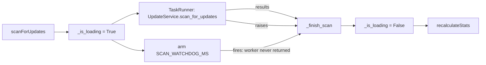

# Spec: Skill Package Update Workflow Reliability

## Requirements

The workflow must satisfy these user-visible guarantees:

1. **A check that cannot complete is reported as a failure**, never as
   "up to date" and never as "0 updates".
2. **A scan always ends.** No code path may leave the view stuck in a loading
   state; a hung worker must be finalised with partial results.
3. **No update is lost to a crash.** Config writes are atomic and never truncate.
4. **A failed check is recoverable** without restarting the app or removing and
   re-adding the package.
5. **The GUI thread is never blocked.** Network probes and updates run on the
   task runner.
6. **Work is bounded.** One remote is probed once per scan, and a burst of
   package changes produces one filesystem rescan.

## Design

### Failure taxonomy

The old `versioning.py` collapsed every outcome — unreachable remote, missing
credentials, no tags, parse failure — into `""`, which the UI could only render
as "no update". `VersionProbe(ok, version, reason)` keeps the distinction, and
`check_status` persists it on the package record.

### Bounded probes

```
env = _git_probe_env()          # GIT_TERMINAL_PROMPT=0, ssh BatchMode=yes, ...
g.execute([...], env=env, kill_after_timeout=DEFAULT_GIT_TIMEOUT)
```

Both arguments were previously omitted, so `git ls-remote` on a credential-gated
remote blocked the scan thread indefinitely.

### Scan lifecycle



`_finish_scan` is the single exit path, so `_is_loading` cannot be stranded.

### Check state machine

See the `check_status` table and state diagram in
[`docs/ARCHITECTURE.md`](../../../docs/ARCHITECTURE.md) § Skill Packages.

### Recovery

`retryPackageCheck(package_id)` runs one bounded probe and re-resolves the record
by `package_id` on the UI thread, so a row removed or reordered mid-probe is not
written to the wrong position.

### Efficiency

- `RemoteProbeCache` is created once per scan and once per add/edit dialog
  submission, and shared across phases.
- `_schedule_discovery_refresh()` coalesces repeated `loadInitialData()` requests
  into a single rescan.

## API changes

| Symbol | Change |
|--------|--------|
| `versioning.VersionProbe` | new |
| `versioning.probe_git_remote_version` | new |
| `versioning.RemoteProbeCache` | new |
| `versioning.count_unchecked_packages` | new |
| `versioning.CHECK_STATUS_*` | new |
| `check_skill_package_versions` | accepts `remote_cache`, records status |
| `UpdateController.retryPackageCheck` | new slot |
| `SourcesMixin.gitVerificationFinished` | new signal |
| `SourcesMixin.verifyGitPackage` | now asynchronous, always returns `""` |
| `AppController.statsUnchecked` | new property |
| `UpdatePackageRecord` | new `check_status`, `check_error`, `last_checked_at`, `update_error` |

## UI

- Header: `· N unchecked` caption next to the update count.
- Row: `· could not check` caption and an amber **Re-check** primary button when
  no newer version is known; a known newer version still shows **Update**.
- Package dialog: the Verify button is fire-and-forget; the result arrives by
  signal and renders inline without closing the dialog.
