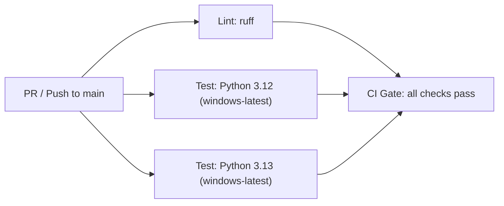
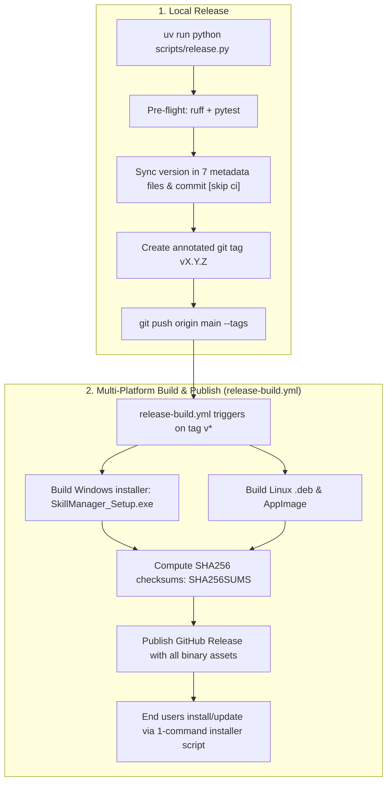
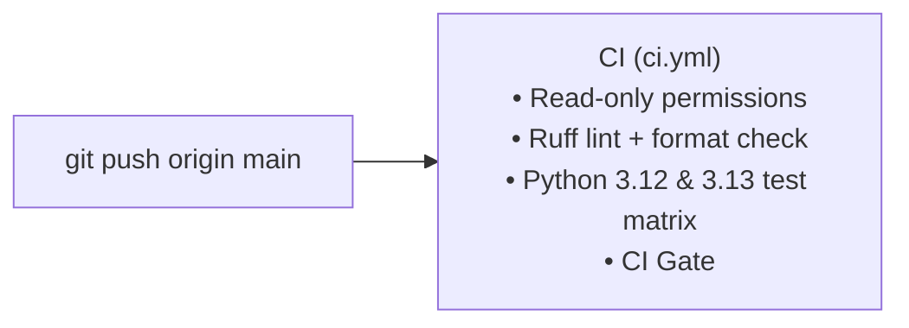

# CI/CD Architecture

## Overview

SkillManager uses GitHub Actions with industry-standard practices: pinned action SHAs, reusable workflows, and automated release builds triggering on tag pushes.

## Workflows

```
.github/workflows/
├── ci.yml                    # PR + main push gate (lint + test + security)
├── release-build.yml         # Multi-platform packaging (Windows .exe + Linux .deb & AppImage)
├── _lint.yml                 # Ruff check + format (reusable)
├── _test-python.yml          # Test suite runner (reusable)
├── _build-pyinstaller.yml    # PyInstaller build for Windows (reusable)
└── _security-scan.yml        # pip-audit (reusable)
```

## CI Pipeline (`ci.yml`)

Triggers: push to `main`, pull requests, manual dispatch.



**Concurrency**: PR runs cancel on new push; main runs queue.

---

## Release Pipeline (`release-build.yml`)

Releases are triggered by a tag you push yourself with `scripts/release.py` — no
workflow bumps the version. The tag then drives a fully automated build:



The Release workflow compiles all platform binaries on native GitHub runners, signs Windows installers (when certificate secrets are present), and attaches verified artifacts to the GitHub Release.

Dev pre-releases (`vX.Y.Z-dev.N` tags) are published with `prerelease: true` and are skipped by the GitHub `/releases/latest` endpoint, so stable users never receive them via `install.sh --update` or the in-app update check. Running `release.py patch` while a dev line is active promotes it to stable. See [VERSIONING.md §4](VERSIONING.md#4-pre-release-versions).

## Action Pinning

All third-party actions are pinned to full commit SHAs (not floating tags). Dependabot automatically proposes weekly updates.

| Action | SHA | Version |
|---|---|---|
| `actions/checkout` | `3d3c42e5...` | v7.0.1 |
| `actions/setup-python` | `5fda3b95...` | v7.0.0 |
| `astral-sh/setup-uv` | `c18668ad...` | v10.2.0 |
| `actions/upload-artifact` | `043fb46d...` | v7.0.1 |
| `actions/download-artifact` | `3e5f45b2...` | v8 |
| `softprops/action-gh-release` | `efb35369...` | v3 |
| `zizmorcore/zizmor-action` | `cc914d7f...` | v0.6.4 |

---

## Push to `main`

A push to `main` runs only `ci.yml`:



No workflow bumps the version or creates a tag on push. Releases start from
`scripts/release.py` on a maintainer's machine, which pushes the release commit and
tag together (see [RELEASING.md](RELEASING.md)).

### `paths-ignore` Behavior

`ci.yml` ignores changes restricted strictly to documentation and reference directories:
```yaml
paths-ignore:
  - 'docs/**'
  - '*.md'
  - 'assets/**'
  - '.agents/**'
  - 'image/**'
  - 'conductor/**'
  - 'LICENSE'
```
- **Doc-only commits** (`docs/`, `README.md`, etc.) are skipped automatically by GitHub Actions.
- **Dependency & lockfile updates** ([`uv.lock`](file:///home/dikka/Documents/01-Projects/27-SkillManager/skill-manager/uv.lock)) or code changes are **not** ignored, so the full gate runs.

---

## Branch Protection

`main` is protected by the repository ruleset `main` (id `25431580`), active since
2026-10-20:

| Rule | Effect |
|---|---|
| `deletion` | `main` cannot be deleted |
| `non_fast_forward` | force-pushes are rejected — for everyone, including the owner |

There are deliberately **no bypass actors**, so `current_user_can_bypass` is
`never`.

**`required_status_checks` is deliberately absent.** In a ruleset it applies to
direct pushes, not only to merges: with no bypass actor the push is rejected
outright — *"push declined due to repository rule violations"* — because the new
commit cannot already have reported the check. Requiring `CI Gate` would block the
release commit and tag that `scripts/release.py` pushes, plus every ordinary push.
The check becomes usable only with a token that can bypass, i.e. a personal access
token.

**There is no "require a pull request" rule, and that is intentional.**
`scripts/release.py` commits the version sync and pushes it straight to `main`. On
a user-owned repository GitHub refuses the GitHub Actions integration as a bypass
actor — *"Actor GitHub Actions integration must be part of the ruleset source or
owner organization"* — so requiring pull requests would mean cutting every release
through a PR. Direct pushes therefore stay allowed; force pushes and deletion do
not.

To get the full set (required checks and PR-only merges), either transfer the
repository to an organization, which permits the integration as a bypass actor, or
authenticate the release push with a personal access token belonging to an account
that can bypass.

No approval count is set: this is a single-maintainer repository, and GitHub does
not let an author approve their own pull request.

## Secret Inventory

| Secret | Purpose | Required |
|---|---|---|
| `GITHUB_TOKEN` | Default token for releases | Yes (auto-provided) |
| `WIN_PFX_B64` | *Retired* — the legacy signing bundle was removed with the 2026-10-19 repository recreation; Windows signing awaits SignPath | No |
| `WIN_PFX_PASS` | *Retired* — passphrase for the removed signing bundle | No |

### Suppressed CVEs

See [docs/SECURITY.md](SECURITY.md) for the list of CVEs silenced in
`pip-audit --ignore-vuln` and the threat-model rationale.

## Local Parity

Run the same checks locally:

```bash
export QML_DISABLE_DISK_CACHE=1  # ADR-0001 — prevents stale QML bytecode
uv run ruff check src tests
uv run ruff format --check src tests
uv run pytest --cov=skill_manager --cov-fail-under=80
```

## Required Repo Settings

No repository-level permission changes are needed. The repository runs with
GitHub's default **read-only** workflow token, because every workflow declares
what it needs in its own `permissions:` block:

- `release-build.yml` — `contents: write` (create the tag and release)
- every other workflow — `contents: read`

Do **not** enable "Allow GitHub Actions to create and approve pull requests": no
workflow opens pull requests, so that setting only widens the token.

## Troubleshooting

### Windows CI fixture rules

The test jobs run on `windows-latest`, so pytest fixtures must be
portable — Linux-green tests have repeatedly broken CI:

- **No backslashes or double quotes in fixture file/dir names.**
  Backslash is a path separator on Windows (`Path("a\\b")` creates two
  levels) and `"` is illegal in Windows names (`WinError 123`). Cover
  backslash-sensitive parsing with platform-independent unit tests and
  guard fixture round-trips with
  `@pytest.mark.skipif(os.name == "nt", reason=...)`.
- **Guard `os.mkfifo` with `(OSError, AttributeError)`.** `os.mkfifo`
  does not exist on Windows — access raises `AttributeError`, not
  `OSError`.
- **Prefer the shared walk in tests too.** When asserting traversal
  behavior, compare against `iter_relative_files()` rather than a
  second inline `os.walk` reference where possible.

### Coverage below threshold
Check `tests/test_coverage_boost.py` for uncovered modules. Add targeted tests for the lowest-coverage source files.

### Release not published after tagging
Check that the tag reached the remote (`git ls-remote --tags origin`) and that
`release-build.yml` ran for it. The version is never bumped on push — run
`uv run python scripts/release.py <bump>`, which creates and pushes the tag.

### Artifact upload fails
Check the specific build job logs in the [release workflow](https://github.com/dishanagalawatta/SkillManager/actions/workflows/release-build.yml).
