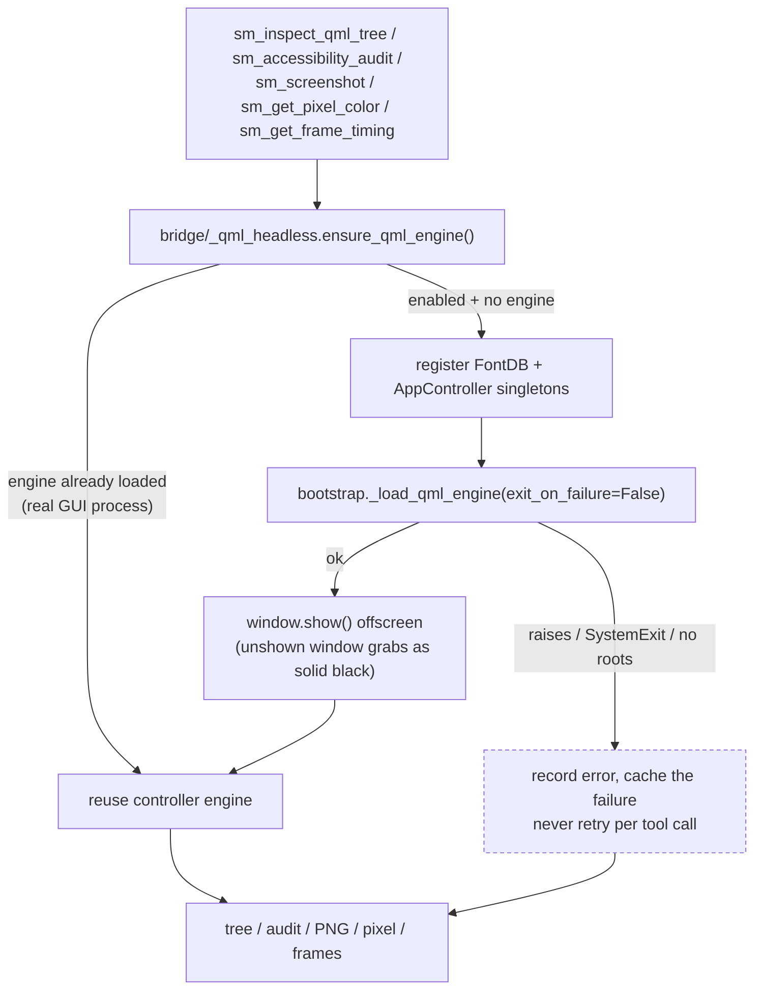

# MCP Server for SkillManager — Design & Tool Reference

> Status: DESIGN LOCKED (2026-07-20)
> Owner: Dishan Agalawatta
> Related: AGENTS.md, docs/ARCHITECTURE.md, docs/DEVELOPMENT.md

## 1. Purpose

Coding agents (opencode, Claude Code, Codex, etc.) currently can only shell out
to dev tooling. They cannot introspect the **live** PySide6 app — its skill/source/
project state, controller health, or diagnostics. This MCP server closes that gap
by exposing build / analyze / monitor / debug tools that bridge directly to the
in-process `AppController` and its sub-controllers.

## 2. Why not the 4 referenced projects?

| Repo | Lang | Result |
|------|------|--------|
| signal-slot/qtmcp | C++20/Qt6 | No Python bindings, tri-GPL — cannot embed in PySide6 |
| Palm1r/llmqore | C++20/Qt6 | No Python bindings (MIT, has `mcp-bridge` binary) |
| logos-co/logos-qt-mcp | C++ plugin + Node | C++ plugin must be compiled in; MIT/Apache |
| TheQtCompanyRnD/agent-skills | Hosted HTTP | Docs-only, no app introspection |

**Conclusion:** All are C++ or hosted-doc. The only embeddable path for a PySide6
app is a **native Python MCP server** using the official `mcp` SDK. logos-qt-mcp's
architecture (in-process inspector + separate MCP process) is the pattern we mirror,
but implemented in Python against `AppController` instead of a C++ plugin.

## 3. Architecture

- New launch mode `--mcp` added to `main()` in `app.py`. Starts an
  `mcp.server.stdio` server on an `anyio` event loop.
- MCP runs on an `anyio` event loop on the **main** thread — the same thread that
  owns `QGuiApplication` — and pumps pending Qt events from a sibling task every
  20 ms, so controller timers and queued signal deliveries keep progressing.
  Tools call `AppController` **in-memory** — zero IPC.
  See [ADR-0040](adr/ADR-0040-mcp-stdio-transport-anyio.md) for why
  `PySide6.QtAsyncio` cannot drive the stdio transport.
- The launcher (`mcp/launcher.py`) pins the **offscreen** Qt platform plugin,
  sets `QQuickStyle("Basic")` + an alpha-8 `QSurfaceFormat` *before*
  `QGuiApplication`, builds one `AppController(skip_initial_load=True)`, disables
  UI-state persistence on it (`UIController.disable_state_persistence()`), shares
  it with the bridge (`set_app_controller`), and enables lazy offscreen QML
  (`enable_headless_qml(True)`). See
  [ADR-0041](adr/ADR-0041-headless-qml-introspection-mcp.md).
- Heavy tools (build, tests) delegate to the existing `BackgroundTaskRunner` and
  return a job id + `sm_job_status` poll, so stdio never blocks.

### Headless UI rendering (offscreen QML)

UI-introspection tools need a `QQmlEngine`, but `--mcp` never loads `Main.qml`
(there is no window). Instead of delegating introspection to a live GUI over IPC
— which requires the very GUI an agent may not have — the bridge loads
`Main.qml` **lazily, in-process, at the first UI-introspection call**:



Key properties (all pinned by tests):

| Property | Behaviour |
|---|---|
| Opt-in | `enable_headless_qml(True)` is called **only** by the `--mcp` launcher; tests and embedding keep "no engine" semantics |
| One engine | `set_app_controller(controller)` shares the launcher's controller, so QML, models and tools never diverge |
| Lazy + cached | ~1.7 s one-time cost (controller 1.1 s + engine 0.6–1.7 s) on the **first** QML-backed call; failures are cached and reported via `sm_get_health().qml` |
| Never fatal | `exit_on_failure=False`; `SystemExit` is caught, so a broken `.qml` file cannot kill the server |
| Must be shown | an unshown offscreen window paints nothing (`grabWindow()` → one colour); the window is `show()`-n, which maps nothing on a desktop under the `offscreen` plugin |
| Never persists | UI-state writes are disabled in the MCP process, so navigation/geometry changes are never saved to the user's `config.json` (asserted byte-for-byte in the stdio integration suite) |
| Provenance | `capture_app_window_info()` returns `source`: `live-gui` (IPC) → `native` (platform API) → `headless-qml`, or `null` with an error |

Real headless output for reference (isolated data dir, default window 880×640):
QML tree = 1 root (`Main_QMLTYPE_41`) + 362 items and 25 named objects
(`navLibrary`, `viewLoader`, `LibraryView`, `libraryList`, …), accessibility
audit = 86 accessible nodes / 7 unnamed controls, screenshot ≈ 30 KB PNG with
≈ 1400 distinct colours.

### Module layout (`src/skill_manager/mcp/`)
```
mcp/
  __init__.py          # registers server with main()
  server.py            # MCPServer factory, stdio transport, tool registry
  launcher.py          # --mcp bootstrap: offscreen platform, shared controller
  bridge/              # thin wrappers over AppController + sub-controllers
    __init__.py        # facade: public bridge API (imports preserved)
    _controller.py     # AppController registry + engine accessor
    _qml_headless.py   # lazy offscreen QML load, show, capture, status
    _capture.py        # capture strategies: IPC / native / headless (+ source)
    _devtools.py       # QML debug bridge
    _input.py          # input-injection helpers (guarded)
    _ipc.py            # CommandChannel IPC, ack dirs
    _jobs.py           # background job registry
    _skills.py         # skill CRUD wrappers
    _state.py          # state snapshot helpers (+ qml status in health)
    _static.py         # repo-root constants, ignore rules
    _telemetry.py      # diagnostics/health aggregation
    _ui_inspection.py  # pixel color, QML tree (window contentItem aware), view
    _qml_object.py     # shared QML type-name + QAccessible role/name reads
    _accessibility.py  # accessible-tree accessibility audit
    _performance.py    # startup time and runtime metrics
    _frame_timing.py   # frame sampling (natural / forced_60hz)
    _visual_analysis.py# visual comparison and layout-issue detection
    _bug_detection.py  # QML errors and UI scenario replay
    _win32.py          # Windows-specific wrappers
  models.py            # pydantic request/response schemas
  tools/               # 13 modules, 40 tools
    build.py analysis.py monitor.py debug.py screenshot.py ui_inspection.py
    accessibility.py performance.py frame_timing.py bug_detection.py
    gui.py skills.py write.py
```

### Lifecycle guard
- `--mcp` uses its own mutex `SkillManagerMcpMutex` (never fights the GUI instance).
- Write tools refuse paths under `TODO.md`, `.agents/commands/`, `.agents/skills/`
  (AGENTS.md exclusions).
- `--mcp-allow-write` absent → write tools return `{ok:false, error:"write mode disabled"}`.
- The process pins `QT_QPA_PLATFORM=offscreen`; `SKILL_MANAGER_MCP_PLATFORM`
  overrides it for debugging (e.g. `xcb` to compare against a real display).
- Headless UI state is never persisted: `UIController.disable_state_persistence()`
  guards `triggerSave`/`saveUiState` for the whole MCP process.
- `SKILL_MANAGER_MCP_NO_IPC=1` disables cross-process IPC: the navigate / capture /
  debug-overlay senders then return `{ok:false, error:"ipc_disabled"}` without
  writing a command file, so an MCP server (or the test suite) can never drive a
  live GUI through the shared `data/mcp/` drop-dir. `sm_screenshot` falls through
  to the platform/native and then the headless offscreen strategy.

## 4. Tool Surface

All tools return structured JSON, names prefixed `sm_`.

**Build** (always on)
- `sm_lint` — `ruff check src tests`, structured error list.
- `sm_run_tests` — `pytest` (subset/full), pass/fail/coverage. Async.
- `sm_build` — `skill-manager-build` (PyInstaller), artifact path. Async.

**Analyze** (always on)
- `sm_list_skills` — from `AppController._library_model`.
- `sm_list_sources` / `sm_list_projects` — configured sources & deploy targets.
- `sm_static_analyze` — safe in-repo symbol/pattern search (respects `.gitignore`).
  File walk reuses the canonical `iter_relative_files()` (ADR-0037): junk
  directories (`.git`, `__pycache__`, `.venv`, `node_modules`, `build`,
  `dist`) are pruned at any depth — directory parts only, so a *file*
  sharing a junk name is still searched — and non-regular files (FIFOs,
  sockets, broken symlinks) are never yielded, so grep cannot block on
  them. Results arrive in deterministic sorted order.

**Monitor** (always on)
- `sm_get_diagnostics` — from `get_diagnostic_logger()` buffer.
- `sm_get_health` — Qt loop alive? controller loaded? model counts; recent exceptions.
- `sm_tail_events` — last N telemetry / `capture_event` entries.
- `sm_profile` — run the discovery pipeline with per-stage timing and report the
  identified bottleneck. Read-only; supports `force_full_scan` to also measure the
  cold (full filesystem scan) path. Useful for perf investigations without a profiler.

**Debug** (always on)
- `sm_dump_state` — serialize `AppController` key state to JSON.
- `sm_inspect_controller` — list a controller's public methods/signals.
- `sm_capture_errors` — in-memory / Sentry error buffer.

**Visual** (always on, read-only)
- `sm_screenshot` — capture the SkillManager window as a base64 PNG. Strategy
  order: live GUI over IPC (`source: "live-gui"`) → platform-native capture
  (`"native"`) → **offscreen headless render of `Main.qml`** (`"headless-qml"`),
  so a screenshot works with no GUI running at all. Optional `navigate`
  (`QuickCopy` | `Library` | `Updates` | `Settings`) switches the view first
  (in-process in headless mode); `save=true` also writes the PNG to
  `.agents/screenshots/`. No window and no engine → `ok=false` with the
  capture error.
  Pixel color, QML tree, and current-view introspection are provided by the
  UI Inspection tools below.

**UI Inspection** (always on, read-only)
- `sm_get_current_view` — return the active view (QuickCopy / Library /
  Updates / Settings) from the `AppController` in this process.
- `sm_inspect_qml_tree` — traverse the QML object tree, returning object name,
  class name, visibility, enabled state, geometry, `child_count` and children up
  to `max_depth`, plus `root_count` / `node_count`. Descends into a
  `QQuickWindow`'s `contentItem()` — a window's own `childItems()` is empty, so
  without that the tree would be a single node. Loads `Main.qml` offscreen on
  demand in headless mode.
- `sm_get_pixel_color` — capture the window and sample the color of one pixel,
  returning `#rrggbb` plus RGB channels. Coordinates are relative to the captured
  image, and `source` reports which capture strategy was used. Useful for
  asserting brand colors, theme tokens, or rendering state without a full
  screenshot.

**Performance** (always on, read-only)
- `sm_measure_startup_time` — time a headless `AppController` operation and
  return startup milliseconds plus an ISO-8601 timestamp. Useful for detecting
  regressions in headless controller construction.
- `sm_get_performance_metrics` — return runtime process metrics via `psutil`:
  memory (MB), CPU percent, thread count, process ID, and uptime seconds. Plus
  Qt/controller health (loop alive, controller present).
- `sm_get_frame_timing` — capture QML render frame timings over a sampling
  window using `QQuickWindow.beforeRendering`/`afterRendering` signals.
  Reports `mode` (`natural` | `forced_60hz` | `unavailable` | `invalid`), FPS,
  avg/p95/max frame duration, and dropped frames. An idle window renders nothing,
  so natural sampling can legitimately return zero frames with an explanatory
  `error` string; pass `force_render=true` to drive a 16 ms `update()` cadence
  and measure real per-frame costs.

**Accessibility** (always on, read-only)
- `sm_accessibility_audit` — audit the UI by walking **Qt's accessible tree**
  (what assistive technology sees): every exposed control with no accessible
  name is reported as `unlabeled_button` (buttons) or `missing_name` (another
  interactive role), with its role, node path and window rect so it can be
  located on a screenshot. Containers, layouts and static text are not in that
  tree, so they are never flagged. Read-only; loads `Main.qml` offscreen on
  demand in headless mode. Against a stock library view (`max_depth=12`) it
  reports 86 accessible nodes and 7 unnamed controls (3 buttons, 4 text
  inputs/dropdowns) — all real app controls.

**Bug Detection** (always on, read-only)
- `sm_detect_qml_errors` — scan the diagnostic ring buffer for QML/JavaScript
  error messages, returning timestamp, level, message, file, line, and column.
- `sm_compare_screenshot` — diff a baseline base64 PNG against the current/live
  capture using PIL `ImageChops`, reporting similarity ratio, diff pixel count,
  total pixels, and whether the result is within a configurable threshold. The
  baseline may be supplied as `baseline_b64` or by `baseline_name` resolving to
  `.agents/screenshots/<name>.png`. Also reports perceptual-hash similarity
  for robustness against anti-aliasing/sub-pixel rendering differences.
- `sm_find_visual_issues` — scan a UI image for visual/layout issues: clipping
  (large uniform regions), low contrast, empty images, using PIL `ImageStat`.
  Each issue has type, severity, description, and location. `image_b64` is
  optional: omit it to analyse the current window (live GUI or headless render);
  the response reports which `source` was used.
- `sm_run_ui_scenario` — execute a predefined UI scenario
  (`navigate_library`, `navigate_quickcopy`, `navigate_updates`,
  `navigate_settings`, `full_tour`) and **verify** each step. In headless mode the
  offscreen window is navigated in-process (`in_process: true`, `verified: true`);
  otherwise the live GUI acknowledges the navigation, so `result: "passed"`
  means the view really changed.

**GUI Interaction** (always on, Windows-only)
- `sm_mouse_move` — move the system cursor to absolute screen pixel coordinates.
- `sm_mouse_click` — click a mouse button at optional (x, y); supports
  left/right/middle and double-click.
- `sm_type_text` — type text (alphanumeric, symbols, Enter, Tab) into the
  currently focused window.
- `sm_get_window_info` — return the live SkillManager window geometry (left, top,
  right, bottom, width, height) for calculating click targets.

**Write** (gated `--mcp-allow-write`)
- `sm_delete_skill`, `sm_deploy` — delegate to `OpsController`/`AppController`.
  Audit-log each call. Refuse AGENTS.md-excluded paths.

## 5. Error Handling & Observability

- `safe_tool()` decorator: catches exceptions → `{ok:false, error, tool}`.
- Job timeouts: build 300s, tests 600s → `timeout` status.
- Every tool call → `capture_event("mcp_tool_call", {tool, args})` (reuse existing
  diagnostics — you can monitor the *agent's* MCP usage).

## 6. Testing

- `tests/test_mcp_*.py`: unit each bridge fn with mocked `AppController`
  (reuse `tests/conftest.py` fixtures); handlers are exercised directly through
  `Server.request_handlers`. No GUI required (controllers build headless, see
  `test_app_controller.py`). Coverage target 80%.
- `tests/test_mcp_stdio_integration.py` (`-m integration`): spawns the **real**
  `python -m skill_manager.__main__ --mcp` process and speaks MCP over its
  stdin/stdout with the official SDK client. Covers the handshake, the full
  `tools/list` surface, representative read-only `tools/call`s, the unknown-tool
  and write-gate error paths, sequential requests, and a clean exit when stdin
  closes. Two headless tests run against an **isolated `HOME`/data dir** and
  assert that the QML tree, accessibility audit, screenshot (`source =
  headless-qml`, non-blank PNG), pixel and forced frame timings all produce real
  data, and that the run leaves the config byte-identical. This is the suite that
  catches stdio-transport and UI-persistence regressions (see
  [ADR-0040](adr/ADR-0040-mcp-stdio-transport-anyio.md),
  [ADR-0041](adr/ADR-0041-headless-qml-introspection-mcp.md)).
- `tests/test_mcp_headless_qml.py` unit-tests the lazy loader with the loader,
  singleton registration, window `show` and encoder monkeypatched: disabled by
  default, reuse of an existing engine, one-shot success, cached failure,
  `SystemExit` survival, empty root objects, capture resize/restore, and the
  `live-gui` / `native` / `headless-qml` capture provenance.
- `tests/test_mcp_server.py` pins the transport plumbing cheaply: the stdio loop
  must be driven by `anyio.run`, never by `PySide6.QtAsyncio`, and the Qt event
  pump must end with the transport.

## 7. Docs / Handoff

- New `docs/MCP_SERVER.md` (this file) — transport, launch, tool reference,
  `.mcp.json` snippet.
- Update `README.md` dev section + `AGENTS.md` quick-reference table.
- Provide `.mcp.json` example for opencode / Claude Code.
- Follow-up: optionally add the hosted **Qt Documentation MCP**
  (`https://qt-docs-mcp.qt.io/mcp`) as a 2nd server for docs-aware coding
  (zero build cost, official, version-pinned Qt 6.8.4 / 6.11.0).

## 8. Decision Log

| Decision | Alternatives | Why |
|---|---|---|
| Native Python `mcp` SDK, stdio | C++ refs, hosted docs MCP | Only embeddable path in PySide6 |
| In-process (`--mcp`) | Out-of-process IPC, build-only | Direct `AppController` access, no IPC bugs |
| Full lifecycle tools | Analyze/monitor-only | Matches explicit user ask |
| Write tools gated `--mcp-allow-write` | Always-open, read-only | Respects AGENTS.md exclusions by default |
| Stdio loop on `anyio.run` + Qt pump task | `PySide6.QtAsyncio`, worker-thread loop | `QAsyncioTask` breaks anyio cancellation; see [ADR-0040](adr/ADR-0040-mcp-stdio-transport-anyio.md) |
| Lazy offscreen `Main.qml` load for UI tools | IPC-delegate to the live GUI; require a running GUI | No GUI needed; one controller; persistence disabled; see [ADR-0041](adr/ADR-0041-headless-qml-introspection-mcp.md) |
| Capture provenance in `source` | Single unnamed capture path | Callers must know whether they got the GUI, a native grab, or the offscreen render |
| `force_render` opt-in for frame timing | Always force redraw | Natural sampling is non-invasive; forcing redraws perturbs what is measured |

## Client Setup & Installation Guides

The SkillManager MCP server runs via stdio. To connect an AI agent or IDE to SkillManager MCP, use one of the client configuration snippets below depending on your agent platform.

### Why a launcher script?

Every config below points the client at `scripts/mcp_launcher.sh` (POSIX) or `scripts/mcp_launcher.bat` (Windows) instead of running `uv` directly. GUI-launched clients (Claude Desktop, Cursor, IDEs, ...) spawn the configured `command` with a **minimal environment** that never sources your shell rc files, so `uv` — which the standalone installer places in `~/.local/bin` (`%USERPROFILE%\.local\bin` on Windows) — is **not on their PATH**, producing `Executable not found in $PATH: "uv"`.

The launcher removes that PATH dependency:

1. It runs the project's own venv Python directly: `.venv/bin/python -m skill_manager.__main__` (Windows: `.venv\Scripts\python.exe`).
2. Only if the venv is missing does it fall back to `uv`, searching PATH first, then `~/.local/bin`.

Replace `/path/to/skill-manager` below with the absolute path of your clone. On Windows, point `command` at `C:\path\to\skill-manager\scripts\mcp_launcher.bat` instead.

### 1. Claude Desktop (`claude_desktop_config.json`)

**Location:**
- macOS: `~/Library/Application Support/Claude/claude_desktop_config.json`
- Windows: `%APPDATA%\Claude\claude_desktop_config.json`
- Linux: `~/.config/Claude/claude_desktop_config.json`

```json
{
  "mcpServers": {
    "skillmanager": {
      "command": "/path/to/skill-manager/scripts/mcp_launcher.sh",
      "args": ["--mcp"]
    },
    "skillmanager-write": {
      "command": "/path/to/skill-manager/scripts/mcp_launcher.sh",
      "args": ["--mcp", "--mcp-allow-write"]
    }
  }
}
```

### 2. Cursor (`.cursor/mcp.json`)

**Location:** `.cursor/mcp.json` at your project root or global settings (`Settings > Features > MCP`).

```json
{
  "mcpServers": {
    "skillmanager": {
      "command": "/path/to/skill-manager/scripts/mcp_launcher.sh",
      "args": ["--mcp"]
    },
    "skillmanager-write": {
      "command": "/path/to/skill-manager/scripts/mcp_launcher.sh",
      "args": ["--mcp", "--mcp-allow-write"]
    }
  }
}
```

### 3. VS Code / Continue (`.mcp.json`)

**Location:** Project root `.mcp.json` or `.vscode/mcp.json`.

```json
{
  "mcpServers": {
    "skillmanager": {
      "command": "/path/to/skill-manager/scripts/mcp_launcher.sh",
      "args": ["--mcp"]
    }
  }
}
```

### 4. Antigravity / Gemini (`.mcp.json` or `mcp_config.json`)

**Location:** Project root `.mcp.json` or `~/.gemini/mcp_config.json`.

```json
{
  "mcpServers": {
    "skillmanager": {
      "command": "/path/to/skill-manager/scripts/mcp_launcher.sh",
      "args": ["--mcp"]
    },
    "skillmanager-write": {
      "command": "/path/to/skill-manager/scripts/mcp_launcher.sh",
      "args": ["--mcp", "--mcp-allow-write"]
    }
  }
}
```

### 5. Goose CLI (`~/.config/goose/config.yaml`)

**Location:** `~/.config/goose/config.yaml`

```yaml
mcpServers:
  skillmanager:
    command: /path/to/skill-manager/scripts/mcp_launcher.sh
    args:
      - --mcp
```

### 6. Windsurf (`.codeium/windsurf/mcp_config.json`)

**Location:** `~/.codeium/windsurf/mcp_config.json`

```json
{
  "mcpServers": {
    "skillmanager": {
      "command": "/path/to/skill-manager/scripts/mcp_launcher.sh",
      "args": ["--mcp"]
    }
  }
}
```

### 7. OpenCode (`opencode.jsonc`)

**Location:** Project root `opencode.jsonc`

```jsonc
{
  "mcp": {
    "skillmanager": {
      "type": "local",
      "command": ["bash", "/path/to/skill-manager/scripts/mcp_launcher.sh", "--mcp"],
      "enabled": true,
      "description": "SkillManager MCP server"
    }
  }
}
```

---

### Comprehensive Tool Reference

| Tool | Description | Gated? |
|------|-------------|--------|
| `sm_list_skills` | List skills in library model | No |
| `sm_get_skill` | Retrieve full details of a single skill (metadata, SKILL.md body, files) | No |
| `sm_search_skills` | Search skills by keyword matching name, category, tags, or content | No |
| `sm_sync_skills` | Re-scan skill source directories into library model | No |
| `sm_list_sources` | List configured skill source directories | No |
| `sm_list_projects` | List configured target project directories | No |
| `sm_create_skill` | Create a new skill directory with SKILL.md | Yes (`--mcp-allow-write`) |
| `sm_update_skill` | Update content or metadata of an existing skill's SKILL.md | Yes (`--mcp-allow-write`) |
| `sm_deploy` | Deploy a skill/package to a target project (`<target>/.agents/skills/`) | Yes (`--mcp-allow-write`) |
| `sm_delete_skill` | Delete a skill (refuses AGENTS.md-excluded paths) | Yes (`--mcp-allow-write`) |
| `sm_lint` | Run `ruff check src tests`, return structured error list | No |
| `sm_run_tests` | Run `pytest` suite in background job | No |
| `sm_build` | Run `skill-manager-build` in background job | No |
| `sm_job_status` | Poll background test/build job status | No |
| `sm_static_analyze` | Safe regex grep over repository (respecting `.gitignore`) | No |
| `sm_get_health` | App & bridge health snapshot | No |
| `sm_get_diagnostics` | Read diagnostic logger ring-buffer events | No |
| `sm_tail_events` | Tail recent telemetry / `capture_event` entries | No |
| `sm_profile` | Run discovery pipeline profiling | No |
| `sm_dump_state` | Export safe subset of controller state | No |
| `sm_inspect_controller` | Introspect sub-controller methods/signals | No |
| `sm_capture_errors` | Return error diagnostic buffer | No |
| `sm_screenshot` | Capture the window (live GUI, native, or headless offscreen render) | No |
| `sm_mouse_move` | Move system cursor (Windows) | No |
| `sm_mouse_click` | Send mouse click (Windows) | No |
| `sm_type_text` | Type text into focused window (Windows) | No |
| `sm_get_window_info` | Return live GUI window geometry | No |
| `sm_get_pixel_color` | Sample RGB/hex color at a pixel of the captured window | No |
| `sm_inspect_qml_tree` | Traverse the QML object tree (name, class, geometry, children) | No |
| `sm_get_current_view` | Return the active view | No |
| `sm_measure_startup_time` | Time headless controller access; return ms + timestamp | No |
| `sm_get_performance_metrics` | Return memory, CPU, thread count, PID, uptime | No |
| `sm_get_frame_timing` | Capture QML render frames; report mode, FPS, p95/max frame ms | No |
| `sm_accessibility_audit` | Audit Qt's accessible tree for controls with no accessible name (role, path, rect) | No |
| `sm_detect_qml_errors` | Scan diagnostic buffer for QML/JavaScript errors | No |
| `sm_compare_screenshot` | Diff baseline vs current PNG; structural + perceptual similarity | No |
| `sm_find_visual_issues` | Scan a PNG (or the current window) for clipping/contrast issues | No |
| `sm_run_ui_scenario` | Run a navigate scenario, verifying each step took effect | No |

### `sm_screenshot` — capture & navigation

Captures a PNG of the SkillManager window and (optionally) drives it to a
different section before capturing. Read-only; never opens or owns a GUI window
of its own.

**Capture strategies (in order)**

| Order | `source` | How |
|---|---|---|
| 1 | `live-gui` | IPC capture request to a running GUI (native `PrintWindow`/`BitBlt` on Windows; platform helper on Linux) |
| 2 | `native` | Direct platform capture by this process (window found but IPC unavailable) |
| 3 | `headless-qml` | The offscreen `Main.qml` window rendered in this process (lazy-loads the engine; see § Headless UI rendering) |

`source` is `null` when every strategy fails, and the response then carries the
capture error.

**Parameters**

| Param | Type | Default | Notes |
|-------|------|---------|-------|
| `navigate` | string (enum) | — | One of `QuickCopy`, `Library`, `Updates`, `Settings`. Switches the view before capture. In headless mode this is an in-process view change; with a live GUI it goes through IPC. Omit to capture the current view. |
| `save` | boolean | `false` | When `true`, also writes the PNG to `.agents/screenshots/Screenshot_<timestamp>.png` and returns `save_path`. |
| `width` | integer | — | Resize the window to this width before capture, then restore the original size. Use with `height` to exercise responsive layouts. |
| `height` | integer | — | Resize the window to this height before capture, then restore the original size. |

**Response envelope**

```json
{ "ok": true, "tool": "sm_screenshot",
  "data": { "image_b64": "<PNG, base64>", "width": 880, "height": 640,
            "view": "Library", "source": "headless-qml", "saved": false } }
```

- `view` is the requested `navigate` value, or the current view when omitted.
- `source` tells you which strategy produced the image (see the table above).
- `saved` / `save_path` reflect the `save` flag.

**Errors**

- No window and no headless engine → `{"ok": false, "error": "..."}` containing
  `not running` (e.g. `SkillManager GUI not running and no headless QML render available`).
- Invalid `navigate` value → `{"ok": false, "error": "invalid navigate value: <v>"}`.
- Live-GUI navigation not acknowledged in time →
  `{"ok": false, "error": "navigation to <view> not acknowledged by GUI"}`.

**Navigation IPC (file-based, cross-process)**

When a GUI runs in another process, navigation uses a drop-dir contract under
`data/mcp/` (gitignored):

1. Server writes `data/mcp/commands/<uuid>.json`:
   `{"action": "navigate", "view": "<view>", "id": "<uuid>"}`.
2. The GUI's `CommandChannel` (`app.py`, a `QFileSystemWatcher` on
   `data/mcp/commands/`) receives `directoryChanged`, parses the command, validates
   the view, sets `self.app.ui.currentView` on the Qt thread, then writes
   `data/mcp/acks/<uuid>.json`: `{"ok": true, "view": "<view>"}` (or
   `{"ok": false, "error": "..."}`).
3. Server polls for the ack, then deletes both files.

In headless `--mcp` mode the same process owns the `CommandChannel` **and** the
offscreen window, so view changes are applied in-process instead of over IPC
(otherwise the server would block on an acknowledgement only it could produce).
Set `SKILL_MANAGER_MCP_NO_IPC=1` to disable the IPC strategies entirely (message
is then `ipc_disabled`), which is how the test suite guarantees it exercises the
headless render even if a GUI happens to be open on the developer's desktop.

Capture itself never touches `ScreenshotController` (the in-app annotation tool,
which is blank when headless). The Windows path uses `PrintWindow` with a
`PW_RENDERFULLCONTENT` fallback to `BitBlt` + `GetDIBits` (via `ctypes` + `PIL`),
so it works even if the window is partially obscured.

### `sm_mouse_click` / `sm_mouse_move` — GUI interaction

These tools operate on the **running** SkillManager desktop window by sending
Win32 mouse events cross-process. They do not require the MCP server to own
the window — they work with any visible desktop window.

**`sm_mouse_move` parameters**

| Param | Type | Required | Notes |
|-------|------|----------|-------|
| `x` | integer | Yes | Absolute screen X coordinate |
| `y` | integer | Yes | Absolute screen Y coordinate |

**`sm_mouse_click` parameters**

| Param | Type | Default | Notes |
|-------|------|---------|-------|
| `x` | integer | — | Optional: move cursor here first; omit to click at current position |
| `y` | integer | — | Optional: paired with `x` |
| `button` | string | `"left"` | One of `"left"`, `"right"`, `"middle"` |
| `double` | boolean | `false` | Double-click when `true` |

**`sm_type_text` parameters**

| Param | Type | Required | Notes |
|-------|------|----------|-------|
| `text` | string | Yes | Text to type. Supports A-Z, 0-9, common symbols, Space, Enter, Tab. Shift-key modulation handled automatically. |

**`sm_get_window_info` response**

Returns the SkillManager window's current geometry. Use the coordinates to
calculate click targets relative to the window:

```json
{ "ok": true, "tool": "sm_get_window_info",
  "data": { "ok": true, "hwnd": 123456, "left": 100, "top": 200,
            "right": 1152, "bottom": 950, "width": 1052, "height": 750 } }
```

**Typical workflow**

1. `sm_get_window_info` → get window position
2. `sm_screenshot` → capture current view
3. Calculate click target: `screen_x = window.left + offset_x`, `screen_y = window.top + offset_y`
4. `sm_mouse_click(x=screen_x, y=screen_y)` → click the target
5. `sm_screenshot` → verify result

### `sm_get_pixel_color` — Pixel color inspection

Reads the color of one pixel from the captured app window, using the same
capture strategy order as `sm_screenshot` (`live-gui` → `native` →
`headless-qml`). Read-only; the server never has to own the window, so this
works headless against the offscreen render.

Coordinates are **relative to the captured image**, not to the desktop: `0, 0`
is the top-left of the window (or of the offscreen render). Add the window's
origin from `sm_get_window_info` when you need desktop coordinates for input
injection.

**Parameters**

| Param | Type | Required | Notes |
|-------|------|----------|-------|
| `x` | integer | Yes | X coordinate in the captured image (0 = left edge) |
| `y` | integer | Yes | Y coordinate in the captured image (0 = top edge) |

**Response envelope**

```json
{ "ok": true, "tool": "sm_get_pixel_color",
  "data": { "color": "#121214", "r": 18, "g": 18, "b": 20,
            "x": 12, "y": 12, "width": 880, "height": 640,
            "source": "headless-qml", "error": null } }
```

- `color` is the hex representation (lowercase `#rrggbb`); `r`, `g`, `b` are
  per-channel integers (0–255).
- `x` / `y` echo the sampled coordinate; `width` / `height` are the captured
  image's dimensions.
- `source` is the capture strategy (`live-gui` / `native` / `headless-qml`), so
  you always know which window was sampled.

**Errors**

- No window and no headless render →
  `{"ok": false, "error": "SkillManager GUI not running and no headless QML render available"}`.
- Coordinate outside the captured image →
  `{"ok": false, "error": "coordinate_out_of_bounds", "width": <w>, "height": <h>}`.
- Capture failure → `{"ok": false, "error": "<reason>"}`.

---

### `sm_inspect_qml_tree` — QML tree inspection

Traverses the QML object tree of the app window, returning object name, class
name, visibility, enabled state, geometry, `child_count` and children up to
`max_depth`. Read-only. In headless `--mcp` mode the engine is lazy-loaded (and
the offscreen window shown) on the first call; failures are cached and surfaced
by `sm_get_health().qml`.

The walker descends into a `QQuickWindow`'s `contentItem()`: a window's own
`childItems()` list is empty, so without that the tree would be a single node.
Result: 1 `QQuickWindow` root + its content item tree (362 items / 25 named
objects for the stock library view).

**Parameters**

| Param | Type | Default | Notes |
|-------|------|---------|-------|
| `max_depth` | integer | `5` | Maximum tree depth to traverse (1–20). |

**Response envelope**

```json
{ "ok": true, "tool": "sm_inspect_qml_tree",
  "data": { "root_count": 1, "node_count": 363, "max_depth": 12, "tree": [
    { "object_name": "", "class_name": "Main_QMLTYPE_41",
      "accessible_role": "Window", "accessible_name": "SkillManager",
      "visible": true, "enabled": true, "x": 0, "y": 0, "width": 880, "height": 640,
      "child_count": 1, "truncated": false, "children": [ ... ] }
  ], "error": null } }
```

- Each node has `object_name`, `class_name`, `accessible_role`,
  `accessible_name`, `visible`, `enabled`, `x`, `y`, `width`, `height`,
  `child_count`, `truncated` and a recursive `children` array.
- `class_name` is the **QML type** (`Main_QMLTYPE_41`, `IconButton_QMLTYPE_22`),
  not the Python class: PySide reports `QQuickItem` for every QML item, which
  cannot identify a control. Nodes that really are plain `QQuickItem` containers
  still report `QQuickItem`.
- `accessible_role` / `accessible_name` are what Qt's accessibility layer
  exposes for the node (both empty for layouts, static text and other
  non-accessible nodes) — the same source `sm_accessibility_audit` classifies,
  so an unnamed control can be located here and diagnosed there.
- `root_count` is the number of top-level QML root objects; `node_count` is the
  total serialized nodes; `truncated` marks nodes whose children were cut at
  `max_depth` (their `child_count` still reports the real count).

**Errors**

- No QML engine (disabled, or the load failed) →
  `{"ok": false, "error": "no_qml_engine"}`.
- AppController unavailable →
  `{"ok": false, "error": "controller_unavailable"}`.

---

### `sm_get_current_view` — Current GUI view

Returns the active GUI view from the headless `AppController`. Read-only; no
parameters.

**Response envelope**

```json
{ "ok": true, "tool": "sm_get_current_view",
  "data": { "view": "Library", "ok": true } }
```

- `view` is one of `QuickCopy`, `Library`, `Updates`, `Settings`, or `"unknown"`
  when the GUI/controller is not available.

**Errors**

- Controller unavailable → `{"ok": false, "error": "AppController unavailable"}`.

---

### `sm_measure_startup_time` — Startup time measurement

Times a headless `AppController` operation and returns milliseconds plus an
ISO-8601 timestamp. Read-only; no parameters. Useful for detecting regressions
in headless controller construction.

**Response envelope**

```json
{ "ok": true, "tool": "sm_measure_startup_time",
  "data": { "startup_ms": 12.3, "timestamp": "2026-10-17T12:00:00Z",
            "ok": true } }
```

- `startup_ms` is the measured time in milliseconds.
- `timestamp` is the ISO-8601 measurement timestamp.

**Errors**

- Measurement failure → `{"ok": false, "error": "<reason>"}`.

---

### `sm_get_performance_metrics` — Runtime performance metrics

Returns runtime process metrics via `psutil` plus Qt/controller health.
Read-only; no parameters.

**Response envelope**

```json
{ "ok": true, "tool": "sm_get_performance_metrics",
  "data": { "memory_mb": 185.5, "cpu_percent": 4.2, "thread_count": 12,
            "process_id": 12345, "uptime_seconds": 3600.0,
            "qt_loop_alive": true, "controller_present": true } }
```

- `memory_mb` is process resident memory in megabytes.
- `cpu_percent` is process CPU usage percentage.
- `thread_count` is the number of threads in the process.
- `process_id` is the OS process ID.
- `uptime_seconds` is the process uptime in seconds.
- `qt_loop_alive` / `controller_present` reflect Qt and controller health.

**Errors**

- Metric collection failure → `{"ok": false, "error": "<reason>"}`.

---

### `sm_detect_qml_errors` — QML/JavaScript error detection

Scans the diagnostic ring buffer for QML/JavaScript error messages.
Read-only.

**Parameters**

| Param | Type | Default | Notes |
|-------|------|---------|-------|
| `limit` | integer | `50` | Maximum number of errors to return (1–500). |

**Response envelope**

```json
{ "ok": true, "tool": "sm_detect_qml_errors",
  "data": { "count": 2, "errors": [
    { "ts": "2026-10-17T12:00:00Z", "level": "ERROR", "msg": "QML error",
      "file": "Main.qml", "line": 42, "column": 15 },
    { "ts": "2026-10-17T12:00:01Z", "level": "WARNING", "msg": "QML warning",
      "file": null, "line": null, "column": null }
  ], "error": null } }
```

- `level` is one of `"DEBUG"`, `"INFO"`, `"WARNING"`, `"ERROR"`.
- Each entry includes `file`, `line`, `column` when available.

**Errors**

- Diagnostic read failure → `{"ok": false, "error": "<reason>"}`.

---

### `sm_compare_screenshot` — Visual comparison (screenshot diff)

Diffs a baseline base64 PNG against the current/live GUI capture using PIL
`ImageChops`. Reports similarity ratio, diff pixel count, and whether the
result is within a configurable threshold. Read-only.

**Parameters**

| Param | Type | Default | Notes |
|-------|------|---------|-------|
| `baseline_b64` | string | Yes | Base64-encoded PNG of the baseline image. |
| `current_b64` | string|null | `null` | If omitted, captures the current GUI window. |
| `threshold` | number | `0.95` | Minimum similarity ratio to consider images "within threshold" (0.0–1.0). |

**Response envelope**

```json
{ "ok": true, "tool": "sm_compare_screenshot",
  "data": { "similarity": 0.98, "diff_pixels": 128, "total_pixels": 640000,
            "within_threshold": true, "issues": [], "error": null } }
```

- `similarity` is the ratio of matching pixels (1.0 = identical).
- `diff_pixels` is the absolute count of differing pixels.
- `within_threshold` is `true` when `similarity >= threshold`.
- `issues` lists human-readable descriptions of significant differences.

**Errors**

- Invalid base64 input → `{"ok": false, "error": "invalid base64 image data"}`.
- Image size mismatch → `{"ok": false, "error": "images must have the same dimensions"}`.
- Invalid `threshold` → `{"ok": false, "error": "threshold must be between 0.0 and 1.0"}`.
- GUI capture failure → `{"ok": false, "error": "unable to capture current GUI"}`.

---

### `sm_find_visual_issues` — Visual issue detection

Scans a UI image for visual/layout issues using PIL `ImageStat`: clipping
(content hard against the frame edge), low contrast, empty images. Each issue
has a type, severity, description, and location. Read-only. `image_b64` is
optional — omit it to analyse the **current** window (live GUI or the offscreen
headless render); the response's `source` says which was used, mirroring
`sm_screenshot`.

**Parameters**

| Param | Type | Default | Notes |
|-------|------|---------|-------|
| `image_b64` | string | — | Base64-encoded PNG to analyze. Omit to capture the current window. |
| `check_clipping` | boolean | `true` | Check for content clipped at the frame edge. |
| `check_contrast` | boolean | `true` | Check for low-contrast areas. |
| `check_overlap` | boolean | `true` | Check for potential overlapping elements. |

**Response envelope**

```json
{ "ok": true, "tool": "sm_find_visual_issues",
  "data": { "issue_count": 1, "source": "headless-qml", "issues": [
    { "type": "clipping", "severity": "medium",
      "description": "Content appears clipped at image edges.",
      "location": { "x": 0, "y": 0, "width": 880, "height": 640 } }
  ], "error": null } }
```

- `type` is one of `clipping`, `contrast`, `empty`, `overlap`, `unknown`.
- `severity` is one of `low`, `medium`, `high`.
- `location` is `{ x, y, width, height }` when localizable, else `null`.
- `source` is `"provided"` when `image_b64` was passed, otherwise the capture
  strategy (`live-gui` / `native` / `headless-qml`).

**Errors**

- Invalid base64 input → `{"ok": false, "error": "invalid base64 image data"}`.
- Image decode failure → `{"ok": false, "error": "unable to decode image"}`.
- No image and capture failed → `{"ok": false, "error": "<capture error>"}`.

---

### `sm_run_ui_scenario` — UI test scenario execution

Executes a predefined UI navigation scenario and **verifies** every step.
Supported scenarios: `navigate_library`, `navigate_quickcopy`,
`navigate_updates`, `navigate_settings`, `full_tour`. Read-only.

In headless `--mcp` mode the offscreen window is navigated in-process
(`in_process: true`) and the current view is read back (`verified: true`).
Otherwise the live GUI must acknowledge each navigation, so `result: "passed"`
means the view actually changed rather than "a command file was written".

**Parameters**

| Param | Type | Default | Notes |
|-------|------|---------|-------|
| `scenario` | string | Yes | One of `navigate_library`, `navigate_quickcopy`, `navigate_updates`, `navigate_settings`, `full_tour`. |
| `params` | object|null | `null` | Optional scenario-specific parameters. |

**Response envelope**

```json
{ "ok": true, "tool": "sm_run_ui_scenario",
  "data": { "scenario": "full_tour", "result": "passed",
            "steps": [
              { "step": 1, "action": "navigate", "target": "Library",
                "ok": true, "verified": true, "in_process": true,
                "error": null, "screenshot": null }
            ], "error": null } }
```

- `result` is `"passed"` or `"failed"`.
- Each step has `step`, `action`, `target`, `ok`, `verified` (in-process
  navigation read-back), `in_process`, `error`, and `screenshot` (currently
  always `null` — call `sm_screenshot` yourself when you want pixels).
- `in_process: true` means the view was set in this process and verified
  immediately; `false` means a live GUI acknowledged the navigation.

**Errors**

- Invalid `scenario` → `{"ok": false, "error": "unknown scenario: <name>"}`
  (the tool schema already rejects values outside the enum).
- Step failure → step entry has `ok: false` with `error` set, and the overall
  `result` is `"failed"`.

---

### `sm_get_frame_timing` — QML render frame timing

Captures QML render frame durations over a sampling window by connecting to
the QML window's `beforeRendering`/`afterRendering` signals. Reports `mode`,
FPS, avg/p95/max frame duration, and dropped frames (frames exceeding
~16.67 ms at 60 Hz). Read-only.

`mode` tells you what was measured:

| `mode` | Meaning |
|---|---|
| `natural` | Sampled the window as-is. An idle UI renders nothing, so `frame_count: 0` with an explanatory `error` is a **normal** result, not a failure. |
| `forced_60hz` | `force_render: true` drove a 16 ms `QTimer` → `window.update()` cadence. `fps` is then cadence-bound; `avg_frame_ms` / `p95_frame_ms` / `max_frame_ms` carry the real signal. |
| `unavailable` | No live render loop (window not exposed, no engine) — reason in `error`. |
| `invalid` | Bad `duration_s`. |

**Parameters**

| Param | Type | Default | Notes |
|-------|------|---------|-------|
| `duration_s` | number | `2.0` | Sampling window in seconds (0.5–30). |
| `force_render` | boolean | `false` | Drive a 60 Hz redraw cadence while sampling. Opt-in: it perturbs what is being measured, but it is the only way to get frames from an idle UI (including the headless offscreen window). |

**Response envelope**

```json
{ "ok": true, "tool": "sm_get_frame_timing",
  "data": { "duration_s": 1.0, "mode": "forced_60hz", "frame_count": 59,
            "fps": 59.0, "avg_frame_ms": 0.55, "p95_frame_ms": 0.69,
            "max_frame_ms": 1.2, "dropped_frames": 0, "samples": [
              { "frame_index": 0, "duration_ms": 0.51, "timestamp": "2026-10-18T12:00:00Z" }
            ], "error": null } }
```

- `fps` is frames per second over the sampling window.
- `avg_frame_ms` / `p95_frame_ms` / `max_frame_ms` are per-frame render durations in milliseconds.
- `dropped_frames` counts frames exceeding ~16.67 ms (60 Hz budget).
- `samples` lists per-frame timing entries.

**Errors**

- Invalid `duration_s` → `{"ok": false, "mode": "invalid", "error": "duration_s must be between 0.5 and 30 seconds"}`.
- No render loop / no engine → returns `ok: true`, `mode: "unavailable"`, `frame_count: 0` and the reason in `error`.
- Idle window → returns `ok: true`, `mode: "natural"`, `frame_count: 0` and a hint in `error` to re-run with `force_render=true`.

---

### `sm_accessibility_audit` — accessibility audit (Qt's accessible tree)

Walks Qt's **accessible tree** — the object tree Qt exposes to assistive
technology — and reports every interactive control with no accessible name.
That is what a screen reader sees, so the audit is accurate and low-noise:
containers (`DialogButtonBox`), layouts and static text are simply not in the
tree, while real controls report a role. Read-only; lazy-loads `Main.qml`
offscreen in headless mode.

If a root exposes no accessible interface at all (a non-QML root, or a Qt build
without the accessibility bridge) the audit degrades to a class-name walk that
still reports interactive-looking elements with no role; `source` says which
traversal produced the result.

**Parameters**

| Param | Type | Default | Notes |
|-------|------|---------|-------|
| `max_depth` | integer | `10` | Maximum accessible-tree depth to audit (1–30). A stock `Main.qml` is ~3 deep, so the default covers it. |

**Response envelope**

```json
{ "ok": true, "tool": "sm_accessibility_audit",
  "data": { "source": "accessible-tree", "element_count": 86, "accessible_nodes": 86,
    "issue_count": 2, "issue_counts_by_type": { "missing_name": 1, "unlabeled_button": 1 },
    "issues": [
    { "object_name": "", "class_name": "IconButton_QMLTYPE_22", "role": "Button",
      "issue_type": "unlabeled_button", "severity": "high", "path": "0.31.4.0",
      "description": "Button 'IconButton_QMLTYPE_22' (IconButton_QMLTYPE_22) has no accessible name.",
      "suggestion": "Set Accessible.name on this button, or give it visible text.",
      "x": 0, "y": 0, "width": 0, "height": 0 },
    { "object_name": "", "class_name": "GlassDropdown_QMLTYPE_58", "role": "ComboBox",
      "issue_type": "missing_name", "severity": "high", "path": "0.22",
      "description": "Interactive element 'GlassDropdown_QMLTYPE_58' (GlassDropdown_QMLTYPE_58) has no accessible name.",
      "suggestion": "Set Accessible.name on this element.",
      "x": 615, "y": 118, "width": 160, "height": 36 }
  ], "error": null } }
```

- `source` is `accessible-tree` (normal), `class-name-fallback` or `mixed`.
- `element_count` counts every node walked; `accessible_nodes` counts those that
  came from Qt's accessible tree.
- `issue_count` is the number of accessibility issues found;
  `issue_counts_by_type` breaks it down by `issue_type`.
- Each issue has `object_name`, `class_name`, `role`, `issue_type`, `severity`,
  `path`, `description`, `suggestion`, plus `x`/`y`/`width`/`height` when the
  node reports a rect. `path` is the node's position in the accessible tree
  (`"0.31.4.0"` = root → child 31 → child 4 → child 0), which disambiguates
  identical-looking controls.
- `issue_type` is one of: `unlabeled_button` (a button), `missing_name`
  (another interactive role), `missing_role` (class-name fallback only: an
  interactive-looking element that exposes no interface at all).
- `severity` is `high` for a missing name and `medium` for a missing role.
- Geometry is window-relative and omitted when unavailable; `0,0,0,0` means the
  control exists in the tree but is not laid out (e.g. inside an unopened panel).
- Roles required to carry a name: Button, CheckBox, ComboBox, EditableText,
  Link, MenuItem, PageTab, RadioButton, Slider, SpinBox, Switch, ToolButton.
  Scroll bars, panes and static text are deliberately excluded — Qt gives them
  no meaningful name and flagging them is noise.

**Errors**

- Invalid `max_depth` → `{"ok": false, "error": "max_depth must be between 1 and 30"}`.
- QML engine unavailable → returns `ok: false` with `error` set to the reason.
