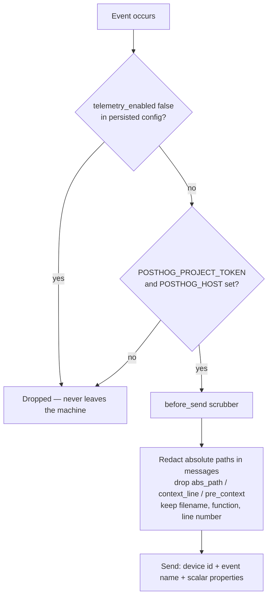

# Product Telemetry

> How SkillManager collects anonymous usage data, what never leaves your
> machine, and how to switch it off.
>
> Design rationale and rejected alternatives live in
> [ADR-0042](adr/ADR-0042-telemetry-privacy-boundaries.md).

## At a glance

Telemetry is **off unless it is configured**, and can be **switched off at any
time**.

An event is sent only when *all three* hold:

1. `POSTHOG_PROJECT_TOKEN` **and** `POSTHOG_HOST` are set, from the process
   environment or an app-owned `.env` (see [Read order](ENVIRONMENT.md#read-order));
2. `ui_state.telemetry_enabled` is not `false` in the persisted config;
3. the process is not a test run (pytest / `SKILL_MANAGER_TESTING=1`).

Release builds ship **no** `.env` — the PyInstaller spec bundles only `assets/`
and `SkillManagerComponents/`. An installed copy therefore sends nothing until
someone deliberately creates `$DATA_DIR/.env` themselves.



## Switching it off (and back on)

**Settings → Diagnostics → Share Anonymous Usage Data.**

- The value is persisted as `ui_state.telemetry_enabled` in `config.json`.
- Switching it **off applies immediately** — the PostHog client is torn down, so
  no further event can leave the machine. No restart is needed.
- The persisted value is read from disk at initialisation, so it also holds for
  the very first event (`app_opened`), independently of Qt or controller
  start-up order.
- Clearing `POSTHOG_PROJECT_TOKEN`, or deleting `$DATA_DIR/.env`, disables
  telemetry just as completely.

## What is sent

| Field | Value |
|-------|-------|
| `distinct_id` | `device_<uuid4 hex>` — random, stored in `$DATA_DIR/device_id.json`, never derived from hardware, hostname, or the user |
| event name | from the catalog below |
| properties | a small set of JSON scalars (counts, booleans, durations, tool names) |
| error reports | exception type and message (paths redacted) plus frame file/function/line number |

## What is never sent

- Absolute filesystem paths, the OS username, or directory trees.
- Source lines (`context_line`, `pre_context`, `post_context`).
- Local variable values from stack frames.
- MCP tool arguments, free-form queries, skill bodies, or file contents.
- Skill archive paths or project labels.
- Sentry request/user context.

## Privacy guards in the code

| Guard | Location | What it enforces |
|-------|----------|------------------|
| Exception scrubber | `core/analytics.py` → `_scrub_posthog_event` | Redacts absolute paths in exception messages; drops frame `abs_path`, `context_line`, `pre_context`, `post_context`, `vars`; keeps bare filename. Never raises — the SDK fails *open* on a `before_send` error. |
| Code variables pinned off | `core/analytics.py` → `_build_client` | `capture_exception_code_variables=False`, so a future SDK default flip cannot start shipping variable contents. |
| MCP allowlist | `core/analytics.py` → `capture_mcp_tool_call` | One central decision point for every MCP event. Drops `args`, `path`, `pattern`, `query`, `skill_id`, `name`, `source_path`, `target`, `content`, `body`, `body_content`, `raw_content`, `text`, `project_label`, and forwards only JSON scalars (`bool`, `int`, `float`, `str`). |
| Credential loading | `core/analytics.py` → `_env_file_candidates` | Resolves `.env` from `$DATA_DIR` then the repo root — **never** the working directory, which would import a launch directory's secrets and let a foreign `POSTHOG_HOST` redirect telemetry. |
| User opt-out | `core/analytics.py` → `_user_disabled_telemetry`, `set_enabled` | Honours the Settings toggle at init and at runtime. |
| Sentry scrubber | `bootstrap.py` → `_scrub_sentry_event` | Strips `request`, `user`, and breadcrumb `data` before an event is sent. |
| Committed-secret guard | `.github/workflows/_lint.yml` → `secret-guard` | Fails CI if `.env` becomes tracked or a `phc_…` token is committed. |

## Event catalog

### Application events

| Event | When | Properties |
|-------|------|------------|
| `app_opened` | The GUI finished loading | — |
| `skill_copied_to_project` | Skills deployed to a project | `skills_copied`, `skills_merged`, `skills_failed`, `skills_count` |
| `skill_archived` | A skill was archived or restored | `action` (`archived` / `restored`) |
| `skill_starred` | A skill was starred or unstarred | `action` |
| `skill_launched` | A skill folder was opened in the OS file manager | — |
| `skill_searched` | A category filter was applied | `filter_type` |
| `skill_package_added` | A skill source was added | `source_type` |
| `skill_package_removed` | A skill source was removed | `source_type` |
| `skill_package_updated` | a source update run finished | `source_type`, `success` |
| `project_target_added` | A project target directory was added | `target_count` |

### MCP events (`--mcp` mode)

All of these except `mcp_bridge_call` pass through `capture_mcp_tool_call`'s
allowlist.

| Event | When | Properties |
|-------|------|------------|
| `mcp_server_start` | The MCP server started | `allow_write`, transport details |
| `mcp_tool_call` | Any MCP tool was invoked | `tool`, plus allowlisted scalars |
| `mcp_write_attempt` | A write tool was invoked | `allowed` |
| `mcp_bridge_call` | A bridge function was called | `fn` |
| `mcp_headless_qml_loaded` | The headless QML engine loaded | — |

## Sentry

Sentry is a separate integration with its own client and its own scrubber
(`bootstrap.py` → `_scrub_sentry_event`). It is disabled when `SENTRY_DSN` is
empty, which is the default in development and staging. The same opt-out
principle applies: no DSN, no reporting.

## Enabling it for development

```bash
# $DATA_DIR/.env  (preferred)  or  <repo>/.env
POSTHOG_PROJECT_TOKEN=phc_your_token
POSTHOG_HOST=https://us.i.posthog.com
```

Never commit this file — `secret-guard` fails the build if `.env` becomes
tracked. Environment variables set in the shell win over the file.

## Verifying the guards

```bash
uv run pytest tests/test_telemetry_privacy.py tests/test_analytics.py
```

These cover the exception scrubber (including malformed payloads), the MCP
allowlist, `.env` resolution, the opt-out, and the committed-secret guard.
