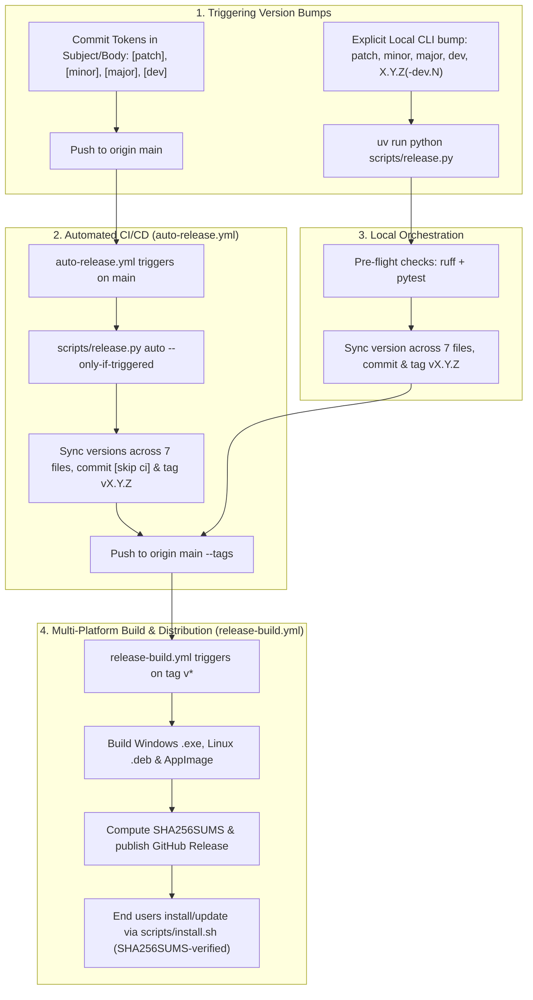
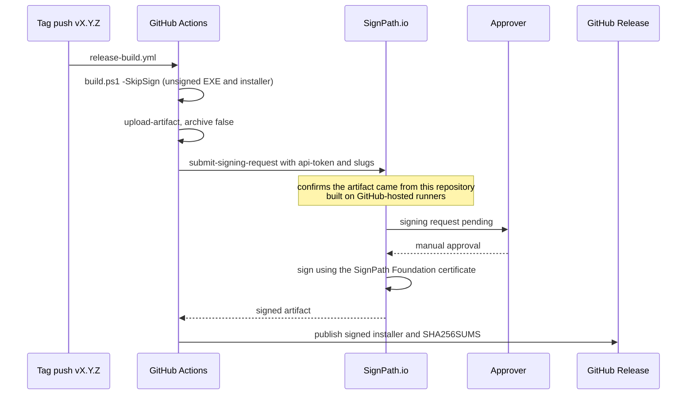

# Release Guide

This document explains the full release and versioning lifecycle for SkillManager.

---

## Overview

SkillManager supports two unified release mechanisms: **Commit-Based Opt-in Tokens** (fully automated via GitHub Actions) and the **Local Release CLI (`scripts/release.py`)**:



---

## Method 1: Commit-Based Automated Version Bumping

You can declare version bumps directly within your Git commit messages using opt-in tokens in the **subject or body**:

| Token / Prefix | Bump Type | Result | Example Commit |
|---|---|---|---|
| `[patch]` / `fix:` | Patch | `x.y.z` → `x.y.(z+1)` | `fix: correct dropdown alignment [patch]` |
| `[minor]` / `feat:` | Minor | `x.y.z` → `x.(y+1).0` | `feat: add new search filter [minor]` |
| `[major]` / `feat!:` | Major | `x.y.z` → `(x+1).0.0` | `feat!: redesign configuration API [major]` |
| `[dev]` | Pre-release | `x.y.z` → `x.y.(z+1)-dev.1` | `fix: experiment with snapshot capture [dev]` |

### How It Operates
1. Include the token anywhere in your commit message (e.g. `feat: add quick copy button [minor]` or in a bullet point inside the commit body `* Added new filter. [minor]`).
2. When pushed to `main`, GitHub Actions (`.github/workflows/auto-release.yml`) scans all commits since the previous release tag.
3. If an unreleased token is detected, it runs `scripts/release.py auto`, commits the version sync across all 7 metadata files, creates the `vX.Y.Z` git tag, and pushes to GitHub.
4. The tag push immediately triggers `.github/workflows/release-build.yml` to compile and publish the multi-platform release.

Commits **without** a token (e.g. `docs: update README`, `chore: lint`) will not trigger a version bump.

---

## Method 2: Automated Release CLI (`scripts/release.py`)

Run the release script directly from the repository root:

```bash
# Auto-detect bump from unreleased commit tokens
uv run python scripts/release.py

# Or force an explicit bump:
uv run python scripts/release.py patch   # 2.0.0 -> 2.0.1
uv run python scripts/release.py minor   # 2.0.0 -> 2.1.0
uv run python scripts/release.py major   # 2.0.0 -> 3.0.0
uv run python scripts/release.py dev     # 2.0.0 -> 2.0.1-dev.1

# Or set an explicit version:
uv run python scripts/release.py 2.0.1
uv run python scripts/release.py 2.0.1-dev.1
```

### CLI Flags

| Flag | Description |
|---|---|
| `--dry-run` | Simulate the entire release and version synchronization without making changes |
| `--skip-tests` | Skip executing `pytest` suite during pre-flight checks |
| `--skip-lint` | Skip executing `ruff` linter during pre-flight checks |
| `--no-push` | Stage, commit, and tag locally without pushing to `origin` |
| `-m`, `--message` | Custom commit and release tag message |

---

## Release Pipeline Step-by-Step

### 1. Pre-flight Checks
The release script ensures the working directory is clean and executes:
- `uv run ruff check src tests`
- `uv run pytest -n auto`

### 2. Version Synchronization
The version is synchronized across all repository components in lockstep:
- `pyproject.toml` (`[project].version`)
- `uv.lock` (regenerated via `uv lock` so the lockfile version never drifts)
- `src/skill_manager/__init__.py` (`__version__`)
- `packaging/windows/installer.iss` (`#define MyAppVersion`)
- `packaging/linux/org.dishanagalawatta.SkillManager.metainfo.xml` (`<release version="...">`)
- `README.md` (version badge)
- `CHANGELOG.md` (release entry)

### 3. Git Tag & Push
The script creates an annotated tag `vX.Y.Z` and pushes to `origin main --tags`.

### 4. GitHub Actions Release Workflow (`release-build.yml`)
When tag `v*` is pushed:
1. **Windows Build Job**: Builds PyInstaller bundle and Inno Setup installer (`SkillManager_Setup.exe`).
2. **Linux Build Job**: Compiles PyInstaller binary, builds `.deb` (`skill-manager_<version>_amd64.deb`), and builds portable `AppImage` (`SkillManager-<version>-x86_64.AppImage`).
3. **Publish Job**: Computes SHA256 checksums (`SHA256SUMS`) and creates the GitHub Release with attached assets.
4. **Pre-releases** (`vX.Y.Z-dev.N` tags) are published with `prerelease: true`, so they are skipped by the GitHub `/releases/latest` endpoint. Stable users never see them via `install.sh --update` or the in-app update check; only explicit `--version` installs target a dev build. See [VERSIONING.md §4](VERSIONING.md#4-pre-release-versions).

### 5. End-User 1-Command Installation
Once published, end users can immediately install or upgrade via the 1-command installer script:
```bash
curl -fsSL https://raw.githubusercontent.com/dishanagalawatta/SkillManager/main/scripts/install.sh | bash -s -- --update
```
The installer verifies every downloaded artifact against the release `SHA256SUMS` manifest
before installation and aborts on any mismatch (see [docs/SECURITY.md](SECURITY.md)).

### 6. Windows Package Manager (winget) — manual, out-of-band
`winget` is **not** published yet, so `winget install --id dishanagalawatta.SkillManager`
currently fails with *"No package found matching input criteria."* Nothing in
`release-build.yml` submits it; the manifest is published by hand to
[`microsoft/winget-pkgs`](https://github.com/microsoft/winget-pkgs).

After a release, copy the newest version folder under
[`packaging/winget/manifests/`](../packaging/winget/README.md) to one named for the new
version, update `PackageVersion`, `InstallerUrl`, `InstallerSha256` (uppercase, from the
release `SHA256SUMS`), `ReleaseDate`, and `ReleaseNotesUrl`, then open a PR adding **only
that folder**. The first submission (v1.8.0,
[#391299](https://github.com/microsoft/winget-pkgs/pull/391299)) was closed as *Stale*
without review. See [`packaging/winget/README.md`](../packaging/winget/README.md) for the
full checklist and the verified values for v2.12.1.

## Windows Code Signing

Windows installers are currently **unsigned**. `release-build.yml` signs only
when the `WIN_PFX_B64` secret is set, and it is not, so `sign.ps1` exits with
`SKIP_SIGN` and SmartScreen shows "More info → Run anyway" on first run (see
[INSTALL.md](INSTALL.md)).

Signing is moving to [SignPath Foundation](https://signpath.org), which issues
certificates to open-source projects free of charge. It is the only free route:
Certum's open-source tier became paid in 2016, Azure Artifact Signing needs a
billed subscription, and a physical token cannot be reached from GitHub-hosted
runners. The previous mechanism cannot simply be re-pointed at a new
certificate — since June 2023 no publicly trusted CA issues an exportable key —
so see [SECURITY.md § Code-Signing Key Exposure & Rotation](SECURITY.md) for the
rationale and the revocation duty.

**Status: application not yet submitted.** Everything below is prepared and
inert until `SIGNPATH_API_TOKEN` exists.

### Signing lifecycle



### Prerequisites (already in place)

- **EXE product metadata.** SignPath's artifact policy requires ProductName and
  ProductVersion to be set and identical across a build. `SkillManager.exe` had
  none; `packaging/windows/version_info.py` now generates the version resource
  from `pyproject.toml` and the spec passes it to `EXE()`. Keep the generated
  values in step with the release — `tests/test_version_sync.py` fails if the
  generator and `pyproject.toml` disagree.
- **Code signing policy** published in [README.md](../README.md), with the
  attribution line and the reviewer/approver roles.
- **All jobs on GitHub-hosted runners**, and the installer is already uploaded as
  a workflow artifact before the release job runs.

### Workflow changes to apply once approved

Replace the "Decode signing cert" step and the secret-gated `build.ps1`
invocation in `release-build.yml`:

```yaml
- name: Build installer (unsigned)
  shell: pwsh
  run: .\packaging\windows\build.ps1 -SkipSign

- name: Upload unsigned installer
  id: upload-unsigned
  uses: actions/upload-artifact@<pinned-sha>
  with:
    name: SkillManager_Setup_unsigned
    path: dist/SkillManager_Setup.exe
    archive: false                 # SignPath wants the raw file, not a ZIP
    if-no-files-found: error

- name: Sign installer
  uses: signpath/github-action-submit-signing-request@<pinned-sha>
  with:
    api-token: ${{ secrets.SIGNPATH_API_TOKEN }}
    organization-id: '<organization id>'
    project-slug: 'skillmanager'
    signing-policy-slug: 'release-signing'
    github-artifact-id: ${{ steps.upload-unsigned.outputs.artifact-id }}
    wait-for-completion: true
    output-artifact-directory: dist
    skip-decompress: true          # pairs with archive: false

- name: Re-upload signed installer
  uses: actions/upload-artifact@<pinned-sha>
  with:
    name: SkillManager_Setup      # the name publish-release expects
    path: dist/SkillManager_Setup.exe
    if-no-files-found: error
```

Pin both `uses:` to full commit SHAs, matching every other action in the
workflow. Then delete the `WIN_PFX_B64` and `WIN_PFX_PASS` secrets; `sign.ps1`
becomes unused and can be kept for local signing or removed.

`build.ps1` currently signs **both** `dist\SkillManager\SkillManager.exe` and the
installer. The SignPath artifact configuration must cover both if both are to
carry a signature, otherwise only the installer is signed.

### Verification

```powershell
Get-AuthenticodeSignature .\SkillManager_Setup.exe | Format-List Status, SignerCertificate
```

`Status` must read `Valid` and the signer must be **SignPath Foundation** — not
your own name, because the certificate is issued to the foundation. Confirm the
same for `dist\SkillManager\SkillManager.exe` if it is configured for signing.

### Constraints to plan around

- **Every release needs manual approval.** A tag push no longer publishes a
  signed installer on its own; the workflow stops until a signing request is
  approved. Budget for that in the release flow, and note it makes prerelease
  tags (`vX.Y.Z-dev.N`) need approval too.
- **The published identity changes.** Add/Remove Programs currently shows the
  `MyAppPublisher` value from `installer.iss` (`dishanagalawatta`) while the
  Authenticode signature will read *SignPath Foundation*. Align `installer.iss`
  once the certificate is in use; it cannot be compiled off Windows, so change it
  where the build can be verified.
- **Eligibility is not guaranteed.** SignPath can decline a project with too
  little public reputation, and their terms provide no appeal. If declined,
  revert the README policy section and revisit paid options.

