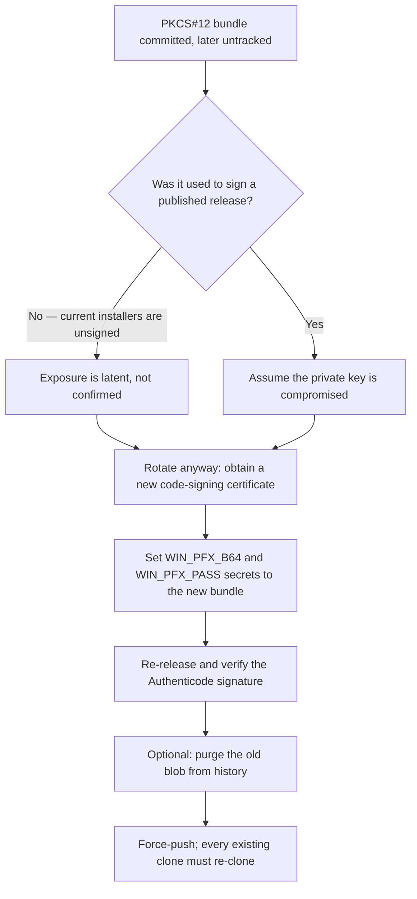

# Security Policy

## Reporting Vulnerabilities

If you discover a security vulnerability, please report it via [GitHub Security Advisories](https://github.com/dishanagalawatta/SkillManager/security/advisories/new).

## Download Integrity

Every release publishes a `SHA256SUMS` manifest alongside its artifacts (`.deb`, `.AppImage`, `.exe`).

- The Linux installer (`scripts/install.sh`) verifies every downloaded artifact against this
  manifest **before** installation and **aborts** on any checksum mismatch — a corrupt or
  tampered file is never installed.
- If the manifest itself (or the artifact's entry) is unavailable — e.g. very old releases
  that predate checksums — the installer warns and proceeds, since the download still travels
  over TLS from GitHub Releases.
- Windows: verify the downloaded `SkillManager_Setup.exe` against the release's
  `SHA256SUMS` manifest (`Get-FileHash .\SkillManager_Setup.exe -Algorithm SHA256`).
  The `winget` package is **not** published in Microsoft's package index, so
  winget is not currently an integrity-verified install channel.

## Code-Signing Key Exposure & Rotation

A Windows code-signing bundle (`packaging/windows/certs/code-signing.pfx`) was
committed to the repository's **root commit** and tracked until it was untracked.
Untracking a file does not remove it from history, and because the file has been
present since the first commit, **every commit and every release tag descends
from a tree containing it** — which is why a purge here is a full history
rewrite rather than a surgical removal.

### What was exposed

- The bundle file itself: an encrypted PKCS#12 exported from the **Microsoft
  Software Key Storage Provider** (one private key and its certificate,
  PBES2-encrypted, SHA-1 MAC).
- The contents are **not** decryptable without the passphrase.

### What was not exposed

The passphrase. CI reads it from the `WIN_PFX_PASS` repository secret and writes
the bundle from `WIN_PFX_B64`. Neither value appears anywhere in the tree or in
history (verified by search). Because the bundle is password-encrypted, an
attacker holding the file alone cannot use the key.

### Why rotation comes first

History rewriting does not invalidate a key. Purging the blob reduces
discoverability but leaves the old key material valid — so rotation is the real
remediation, and it is the step that cannot be done from inside the repository
(issuing a certificate is an external, account-bound action). Treat the previous
key as retired once a replacement is in use.



### Rotation

1. Obtain a new code-signing certificate and export it as a password-protected
   PFX. Do not write it into the working tree.
2. Update the `WIN_PFX_B64` and `WIN_PFX_PASS` repository secrets.
3. Cut a release and confirm the installer is Authenticode-signed
   (`Get-AuthenticodeSignature .\SkillManager_Setup.exe`). The
   `release-build.yml` sign step skips silently when the secret is unset, so an
   unsigned installer means the secret is missing rather than that signing
   failed.
4. Revoke the superseded certificate with the issuing authority if it was
   CA-issued.

### Optional history purge

**Blast radius, measured:** the bundle was added in the repository's **root
commit**, so no commit is free of it — every descendant hash changes. Purging it
rewrites **all commits and all release tags**, not one file from a long history:

```bash
git rev-list --count HEAD                                              # 108 commits
git rev-list --count c0ad749..HEAD                                     # 107 — i.e. all but the root
git for-each-ref --format='%(refname:short)' refs/tags | wc -l          # 87 tags, every one moves
git rev-list --max-parents=0 HEAD                                      # the root is where it was added
```

That means every clone breaks, every release tag is force-updated, and every
recorded commit SHA in changelogs, release notes, and issue links stops
resolving. For a published project, that is a large permanent cost for one
*encrypted* file whose passphrase was never exposed.

**It also does not guarantee the file is gone.** A force-push makes the blob
unreachable from a normal fetch, but GitHub retains unreachable objects, and
cached views and forks can keep serving it by SHA. Deleting it from GitHub's
servers requires asking GitHub Support to run garbage collection. Do not treat a
force-push as proof of removal.

Given that, the recommended position is: **rotate and do not rewrite.** The
exposure is an encrypted bundle with a secret passphrase, and rotation retires
the key that the file protects, which is the part that carries risk.

If a rewrite is still wanted, it requires a clean working tree and is best done
from a fresh clone so no local work is at risk:

```bash
git clone --no-local git@github.com:dishanagalawatta/SkillManager.git /tmp/purge && cd /tmp/purge
git filter-repo --invert-paths --path packaging/windows/certs/code-signing.pfx
git push --force-with-lease origin main
git push --force --tags origin    # 87 tags move with the rewrite
```

Anyone who has already cloned must re-clone rather than pull, and GitHub Support
should be asked to purge the unreachable object.

## Shell Command Construction

Package `verify_command` strings are generated from user-influenced paths
and must follow three rules (see ADR-0038; fixed in PR #285, hardened
in PR #288):

- **Quote every interpolation**: all generated paths go through
  `shlex.quote()` — including paths inside `echo` text, where double
  quotes alone do not stop shell breakout.
- **Never execute through a shell**: `run_shell_command` parses
  `test -d ... && echo ...` in pure Python
  (`intercept_cross_platform_command`) and otherwise uses
  `shlex.split(...)` with `shell=False`. There is no `shell=True` path.
- **Parse without escape processing**: the interceptor uses
  `_split_shell_like()`, which keeps backslashes literal so Windows
  paths survive on every platform. Do not "simplify" it back to
  `shlex.split` — POSIX mode eats backslashes (`C:\foo` → `C:foo`).
  Note `shlex.quote` output is POSIX-style; it is safe here precisely
  because nothing is ever executed by a real shell (it is documented
  as unsafe for `cmd.exe` / PowerShell under `shell=True`).

## Suppressed CVEs

The following CVEs are known in pinned dependencies but are **not exploitable
in this app's threat model** and are suppressed via `pip-audit --ignore-vuln`.

### CVE-2025-69872 — `diskcache 5.6.3` (pickle deserialization RCE)

- **Status**: Unfixed upstream (5.6.3 is the latest version on PyPI).
- **Pre-condition**: Attacker needs write access to the cache directory
  (`DATA_DIR/cache/discovery`).
- **Why suppressed**: This is a single-user desktop app. The cache directory
  lives in the user's own profile folder, which the user already controls.
  An attacker with write access to that folder has the user's account and can
  run code via many other vectors (startup folder, scheduled tasks, etc.).
  The CVE does not materially increase the attack surface.
- **Revisit when**: `diskcache` releases a version >= 5.6.4 with a fix.


