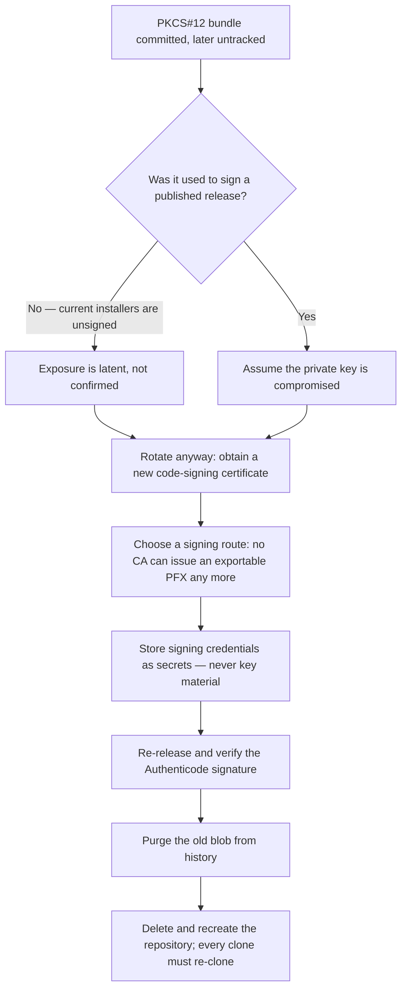

# Security Policy

## Reporting Vulnerabilities

If you discover a security vulnerability, please report it via [GitHub Security Advisories](https://github.com/dishanagalawatta/SkillManager/security/advisories/new).

## Download Integrity

Every release publishes a `SHA256SUMS` manifest alongside its artifacts (`.deb`, `.AppImage`, `.exe`).

- The Linux installer (`scripts/install.sh`) verifies every downloaded artifact against this
  manifest **before** installation and **aborts** on any checksum mismatch — a corrupt or
  tampered file is never installed.
- If the manifest itself (or the artifact's entry) is unavailable — e.g. very old releases
  that predate checksums — the installer warns and proceeds, since the download still travels
  over TLS from GitHub Releases.
- Windows: verify the downloaded `SkillManager_Setup.exe` against the release's
  `SHA256SUMS` manifest (`Get-FileHash .\SkillManager_Setup.exe -Algorithm SHA256`).
  The `winget` package is **not** published in Microsoft's package index, so
  winget is not currently an integrity-verified install channel.

## Code-Signing Key Exposure & Rotation

A Windows code-signing bundle (`packaging/windows/certs/code-signing.pfx`) was
committed to the repository's **root commit** and tracked until it was untracked.
Untracking a file does not remove it from history, and because the file has been
present since the first commit, **every commit and every release tag descends
from a tree containing it** — which is why a purge here is a full history
rewrite rather than a surgical removal.

### What was exposed

- The bundle file itself: an encrypted PKCS#12 exported from the **Microsoft
  Software Key Storage Provider** (one private key and its certificate,
  PBES2-encrypted, SHA-1 MAC).
- The contents are **not** decryptable without the passphrase.

### What was not exposed

The passphrase. CI reads it from the `WIN_PFX_PASS` repository secret and writes
the bundle from `WIN_PFX_B64`. Neither value appears anywhere in the tree or in
history (verified by search). Because the bundle is password-encrypted, an
attacker holding the file alone cannot use the key.

### Why rotation comes first

History rewriting does not invalidate a key. Purging the blob reduces
discoverability but leaves the old key material valid — so rotation is the real
remediation, and it is the step that cannot be done from inside the repository
(issuing a certificate is an external, account-bound action). Treat the previous
key as retired once a replacement is in use.



### Rotation

Since **1 June 2023** the CA/Browser Forum Baseline Requirements require code
signing private keys to be generated and held on a hardware crypto module
(FIPS 140-2 Level 2 / Common Criteria EAL 4+) and to be **non-exportable**. No
publicly trusted CA can issue a downloadable PFX any more.

That means the original mechanism cannot be reproduced: `WIN_PFX_B64` holding a
base64 bundle that `sign.ps1` feeds to `signtool /f ... /p ...` requires an
exportable private key, which no longer exists for a trusted certificate. The
committed bundle was therefore self-signed, pre-2023, or a test artifact — and
the release workflow never actually signed, because the secrets are unset.
**Rotation replaces the signing mechanism, not just a secret value.**

| Route | Where the key lives | CI fit | Cost | Gate |
|---|---|---|---|---|
| SignPath Foundation | Their HSM | Native, via their signing action | Free for OSS | Genuinely non-commercial OSS; a human approves each release |
| Cloud signing service (SSL.com eSigner, DigiCert KeyLocker, Certum SimplySign) | Provider HSM | Native CLI/action; secrets are API credentials | ~$120–380/yr | Paid account; identity validation |
| Azure Artifact Signing | Microsoft HSM | Native action | ~$120/yr | Region-gated (see below) |
| Physical token (YubiKey FIPS, SafeNet eToken) | USB token | **None** — requires a self-hosted runner with the token attached | Token + cert | Not viable on GitHub-hosted runners |
| Self-signed certificate | Local file | Trivial | Free | **Does not help** — untrusted publisher, SmartScreen unchanged |

Azure Artifact Signing is restricted: Public Trust certificates are available to
organizations in the US, Canada, the EU, the UK, Australia, New Zealand, Japan,
South Korea, Singapore, Switzerland, Norway and Israel, and to **individual
developers only in the US and Canada**. Check eligibility before designing
around it.

Steps once a route is chosen:

1. Provision the certificate or signing service and note the credentials the
   provider issues (typically an API username, password, and TOTP secret — not a
   key file).
2. Set those as repository secrets. **Never** store key material in the tree;
   `*.pfx` / `*.p12` are gitignored for that reason.
3. Replace the "Decode signing cert" step and the `sign.ps1` invocation in
   `.github/workflows/release-build.yml` with the provider's signing action or
   CLI, passing credentials via `env`.
4. Cut a release (`scripts/release.py <bump>`, merge the release PR, then
   `scripts/release.py tag`) and confirm the signature:
   `Get-AuthenticodeSignature .\SkillManager_Setup.exe` must report `Valid`.
5. Revoke the superseded certificate with the issuing authority. The blob is
   already out of the repository (see below), but revocation is what actually
   retires the key itself.

Note that public code signing certificate validity is now capped at **460 days**
for certificates issued on or after 1 March 2026, so reissuance recurs roughly
annually and the workflow should make it a one-secret-change operation.

Signing also does not buy an immediate SmartScreen pass: since March 2024 EV and
OV certificates build reputation the same way, through download volume.

### History purge (executed 2026-10-19)

**Blast radius:** the bundle was added in the repository's **root commit**, so no
commit is free of it and every descendant hash changes. A purge rewrites **all**
commits and **all 87 tags**, not one file out of a long history. Every existing
clone breaks, every release tag is force-updated, and every commit SHA recorded in
changelogs, release notes, and issue links stops resolving.

**A rewrite alone would not have removed it.** GitHub keeps a
`refs/pull/<n>/head` ref for every pull request ever opened, and those refs are
server-managed: they cannot be force-pushed, rewritten, or deleted from a client.
Measured before the purge:

```bash
git ls-remote origin | grep -c 'refs/pull/'        # 296 pull refs
# 138 of them resolved packaging/windows/certs/code-signing.pfx
# to blob 406110ccb6e19426d700061ca771e8546a8008af
```

Rewriting `main` and the tags would have changed every SHA in the project and
still left the blob fetchable with `git fetch origin pull/143/head`. Removal was
therefore done by **deleting and recreating the repository**, which drops the pull
refs along with the history:

1. Rewrote a scratch clone with
   `git filter-repo --invert-paths --path packaging/windows/certs/code-signing.pfx`
   — 724 commits and 87 tags, verified to hold no key material in any ref.
2. Deleted and recreated the public repository, preserving visibility, default
   branch, and feature flags.
3. Pushed the rewritten `main` and all 87 tags.
4. Recreated no releases: the 56 historical releases were deliberately dropped
   rather than re-uploading 36.5 GB of assets. Future releases publish normally.
5. Purged the local clone (`git reflog expire --expire=now --all`, then
   `git gc --prune=now`) and deleted the pre-delete backup bundle. The retained
   history backup is a post-rewrite bundle that contains no key material.

Verified afterwards: zero pull refs, the blob absent from the object database and
from every ref on the remote, and `git fetch origin pull/143/head` failing.

**Cost paid:** every pull request and its discussion, the 56 releases and their
assets, star and fork history, and every commit SHA recorded in changelogs and
issue links. File contents and tree state did not change — only hashes.

**The remaining duty is revocation.** Ask the issuing authority to revoke the
certificate: removal retires a copy of the key, revocation retires the key.

## Shell Command Construction

Package `verify_command` strings are generated from user-influenced paths
and must follow three rules (see ADR-0038; fixed in PR #285, hardened
in PR #288):

- **Quote every interpolation**: all generated paths go through
  `shlex.quote()` — including paths inside `echo` text, where double
  quotes alone do not stop shell breakout.
- **Never execute through a shell**: `run_shell_command` parses
  `test -d ... && echo ...` in pure Python
  (`intercept_cross_platform_command`) and otherwise uses
  `shlex.split(...)` with `shell=False`. There is no `shell=True` path.
- **Parse without escape processing**: the interceptor uses
  `_split_shell_like()`, which keeps backslashes literal so Windows
  paths survive on every platform. Do not "simplify" it back to
  `shlex.split` — POSIX mode eats backslashes (`C:\foo` → `C:foo`).
  Note `shlex.quote` output is POSIX-style; it is safe here precisely
  because nothing is ever executed by a real shell (it is documented
  as unsafe for `cmd.exe` / PowerShell under `shell=True`).

## Suppressed CVEs

The following CVEs are known in pinned dependencies but are **not exploitable
in this app's threat model** and are suppressed via `pip-audit --ignore-vuln`.

### CVE-2025-69872 — `diskcache 5.6.3` (pickle deserialization RCE)

- **Status**: Unfixed upstream (5.6.3 is the latest version on PyPI).
- **Pre-condition**: Attacker needs write access to the cache directory
  (`DATA_DIR/cache/discovery`).
- **Why suppressed**: This is a single-user desktop app. The cache directory
  lives in the user's own profile folder, which the user already controls.
  An attacker with write access to that folder has the user's account and can
  run code via many other vectors (startup folder, scheduled tasks, etc.).
  The CVE does not materially increase the attack surface.
- **Revisit when**: `diskcache` releases a version >= 5.6.4 with a fix.


