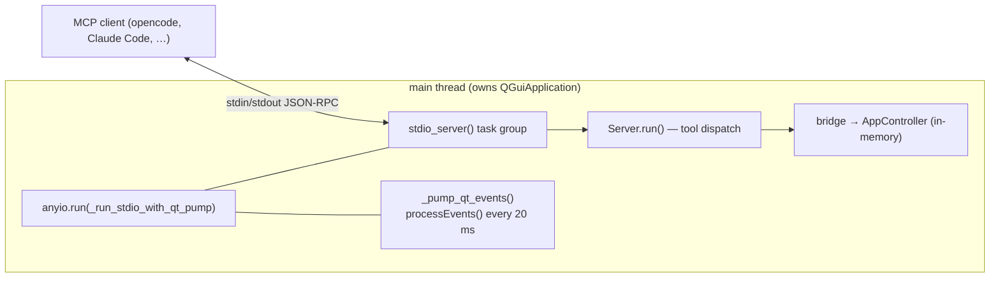

# ADR-0040: MCP Stdio Transport Runs on `anyio`, Not `QtAsyncio`

> Status: **Accepted**
> Date: 2026-10-18
> Owner: @DIKKA

## Context

`skill-manager --mcp` exposes the SkillManager MCP server over stdio. The MCP
Python SDK implements that transport with **anyio** (`mcp.server.stdio.stdio_server`),
while SkillManager owns a **Qt** event loop and a `QGuiApplication`-affine
`AppController`.

The original implementation tried to reconcile the two with PySide6's
`QtAsyncio` module (`qt_asyncio.run(_run_stdio(server))`), on the assumption that
Qt's loop could pump the asyncio loop so the transport would run without
blocking Qt.

That assumption is false, and the failure is silent at the protocol level:

- anyio's asyncio backend delivers cancellation by touching CPython private
  `asyncio.Task` state (`task._must_cancel`, `task._fut_waiter`).
- `QtAsyncio` runs its own `QAsyncioTask`, which does **not** implement those
  attributes. The first cancellation delivered inside the stdio task group
  raises `AttributeError: 'QAsyncioTask' object has no attribute '_must_cancel'`.
- `QtAsyncio.run(coro)` also defaults to `keep_running=True`, so the loop is
  designed to outlive the coroutine instead of terminating with it.

Net effect: the server process started, logged `Initializing server
'SkillManager'` and `Registering handler for ...`, then answered **no request
ever** — `initialize`, `tools/list` and every `tools/call` hung until the client
timed out — and the process never exited when the client closed stdin. All 40
tools were unreachable from any MCP client.

## Decision

Run the MCP stdio loop with `anyio.run(...)` on the **main thread** — the same
thread that owns `QGuiApplication` — and keep Qt alive from inside that loop with
a sibling task that calls `QCoreApplication.processEvents()` every 20 ms
(`skill_manager.mcp.server._pump_qt_events`).

`PySide6.QtAsyncio` is no longer used by the MCP transport at all. The
`--mcp-light` variant runs the same `_run_stdio` coroutine via `anyio.run`
without the Qt pump, since it never touches a `QGuiApplication`.

## Consequences

### Positive

- `initialize`, `tools/list` and `tools/call` answer correctly over real stdio;
  all 40 tools are reachable (verified end-to-end against the real subprocess).
- The process exits cleanly (code 0) when the client closes stdin, so MCP
  clients can shut the server down.
- Qt objects stay thread-affine: `AppController` is constructed and used on the
  main thread, exactly as in GUI mode.
- One event-loop technology (anyio/asyncio) for the transport; no private
  `asyncio.Task` coupling remains on the SkillManager side.

### Negative

- Qt's own loop never runs `app.exec()` in `--mcp` mode, so Qt work only
  progresses at the pump cadence (20 ms) and only while the stdio loop yields.
  Tools that depend on continuous rendering (frame timing, live QML repaint)
  remain degraded in headless MCP mode; they already reported that state.
- Two cooperating schedulers on one thread need a guard against future
  re-entrancy. The pump swallows all exceptions by design so it can never take
  the server down, which also means pump failures are invisible unless logged.

### Neutral

- `_run_in_thread` (the previous "no QtAsyncio available" fallback) was removed
  as dead code; `anyio` is a hard dependency of the `mcp` SDK.
- `run_mcp_server_light` switched from `asyncio.run` to `anyio.run` so both
  entry points share one transport path.

## Alternatives Considered

### Keep `QtAsyncio`, patch anyio's task assumptions

Monkeypatching `QAsyncioTask._must_cancel` from SkillManager would couple us to
CPython `asyncio` internals *and* to PySide6 internals simultaneously, and would
break on either upgrade. Rejected.

### Run the asyncio loop in a worker thread, pump Qt on the main thread

Threading the transport works, but every tool call would then execute bridge
code on the worker thread, where `QGuiApplication`-affine objects (models,
QML engine, timers) are unsafe to touch. Rejected.

### Reimplement the stdio transport without anyio

The MCP SDK's `Server.run` itself builds anyio task groups internally, so a
custom transport would not sidestep the incompatibility. Rejected.

### Keep `keep_running=True` and accept a server that never exits

Leaves MCP clients unable to stop the server and hides the transport failure
behind a live process. Rejected.

## References

- `src/skill_manager/mcp/server.py` — `run_mcp_server`, `_run_stdio_with_qt_pump`, `_pump_qt_events`
- [ADR-0041](ADR-0041-headless-qml-introspection-mcp.md) — the lazy offscreen QML load that this transport makes possible
- `tests/test_mcp_stdio_integration.py` — end-to-end stdio regression suite
- `tests/test_mcp_server.py` — transport plumbing guards (`anyio`, not `QtAsyncio`)
- [MCP Python SDK](https://github.com/modelcontextprotocol/python-sdk) — `mcp.server.stdio`
- [PySide6 QtAsyncio](https://doc.qt.io/qtforpython-6/PySide6/QtAsyncio/index.html)
