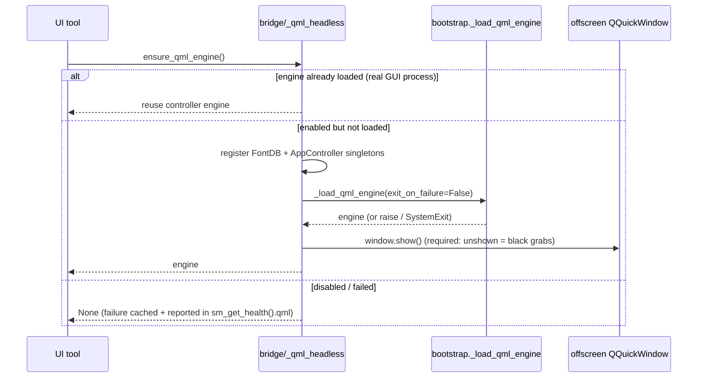

# ADR-0041: Lazy Offscreen QML Introspection in `--mcp` Mode

> Status: **Accepted**
> Date: 2026-10-18
> Owner: @DIKKA

## Context

`--mcp` runs the SkillManager MCP server without a GUI. Its UI-introspection
tools (`sm_inspect_qml_tree`, `sm_accessibility_audit`, `sm_screenshot`,
`sm_get_pixel_color`, `sm_get_frame_timing`) read the `QQmlEngine` owned by the
in-process `AppController`, but nothing ever loaded `Main.qml` in that process:

- `AppController(skip_initial_load=True)` deliberately skips the QML load, and
  the GUI launcher is a *different* process.
- So every UI tool answered `no_qml_engine`, `sm_screenshot` could only return
  `ok:false` when no GUI was running, and the accessibility audit found 0
  elements. The MCP server was blind to the UI it was supposed to verify.

Three ways out were on the table: (a) delegate introspection to a live GUI over
IPC, (b) load `Main.qml` offscreen inside the MCP process, (c) keep the tools but
accept they only work when a GUI happens to run.

`--mcp-light` is not affected: it never touches `QGuiApplication` and exposes no
UI tools.

### Constraints discovered while prototyping

| Finding | Consequence |
|---|---|
| An **unshown** offscreen window paints nothing — `grabWindow()` returns a single-colour image | The window must be `show()`-n before any capture |
| Under the `offscreen` plugin, `show()` maps nothing on the desktop | Safe in headless/CI: no window ever appears for the user |
| `QQuickStyle.setStyle("Basic")` and an alpha-8 `QSurfaceFormat` must be set **before** `QGuiApplication` exists | The launcher must configure Qt before constructing the app object |
| `FontDatabaseBridge` must be registered as the `FontDB` QML singleton before engine creation, otherwise QML text metrics fail | Singleton registration is a load prerequisite, not an option |
| Loading `Main.qml` costs ~1.7 s (controller 1.1 s + engine 0.6–1.7 s) | The load cannot be eager on every MCP start |
| The app's QML startup logic (and `UIController`) writes UI state to `config.json` | A *headless observer* must never persist the user's window geometry/view |
| `QQuickWindow.childItems()` is empty — QML content lives under `contentItem()` | A tree walk over `childItems()` alone reports a single node |

## Decision

Load `Main.qml` **lazily, opt-in, and in-process** on the first UI-introspection
call, and treat the offscreen render as a first-class capture source.

1. **Opt-in**: `enable_headless_qml(True)` is called only by
   `mcp/launcher.py`. Tests and embedded use keep the previous "no engine"
   semantics, so nothing changes for them.
2. **One controller**: `set_app_controller(controller)` shares the launcher's
   `AppController` with the bridge. Without it the bridge lazily builds a
   *second* controller, and QML-driven state changes would land on an instance
   the tools never read (this actually happened while prototyping and silently
   persisted UI state through the wrong instance).
3. **One-shot, never fatal**: the attempt is recorded before loading, failures
   (including `SystemExit` from the legacy `exit_on_failure` path) are cached and
   reported via `sm_get_health().qml = {enabled, loaded, attempted, error,
   root_count}`. A broken `.qml` file cannot kill the server.
4. **Show, then capture**: `_show_offscreen_window()` `show()`s the window and
   processes events; `capture_headless_window()` temporarily applies a requested
   size, grabs, and restores the original size.
5. **Never persist**: the launcher calls
   `UIController.disable_state_persistence()`, which guards both `triggerSave`
   (debounced) and `saveUiState` (direct). The stdio integration suite asserts
   the config file is **byte-identical** across a headless run that loads QML,
   switches views and captures a screenshot.
6. **Provenance**: `capture_app_window_info()` tries IPC `live-gui` → platform
   `native` → `headless-qml` and reports `source`; a caller always knows which
   window it is looking at.
7. **Honest frame timing**: `sm_get_frame_timing` reports `mode`
   (`natural` / `forced_60hz` / `unavailable` / `invalid`) and explains a
   zero-frame natural sample instead of returning a silent `0 fps`. Opt-in
   `force_render=true` drives a 16 ms `update()` cadence — the only way to get
   frames out of an idle or offscreen window.
8. **Deterministic navigation**: headless `--mcp` owns both the offscreen window
   and the `CommandChannel` that consumes navigation commands, so an IPC
   navigate + ack-wait would deadlock against itself. `navigate_view()` sets the
   view in-process (and verifies it) when headless, and only uses IPC + ack when
   the live GUI really is another process.
9. **Window-aware tree walk**: the inspector descends into a window's
   `contentItem()` (falling back to `childItems()`), so `sm_inspect_qml_tree`
   returns the real tree, and nodes carry `child_count` / `truncated`.

## Consequences

### Positive

- The UI tools are useful with **no GUI running**: verified against the real
  subprocess — 1 root (`Main_QMLTYPE_41`) + 362 items across 25 named objects
  (`navLibrary`, `viewLoader`, `LibraryView`, `libraryList`, …), 86 accessible
  nodes / 7 unnamed controls, a ~30 KB PNG with ~1400 distinct colours, and 59
  frames in a 1 s forced-render sample.
- View navigation works headlessly and is verified, so agents can screenshot any
  section without a desktop session.
- No new IPC surface, no second process, no display: the whole feature is
  in-process and read-only.
- The persistence guard makes "observe the UI" safe for the user's data, with a
  byte-comparison regression test rather than a promise.

### Negative

- First UI-tool call in a fresh `--mcp` process costs ~1.7 s (lazy, one-time).
- The offscreen render is not pixel-identical to a composited desktop: no window
  decorations/animations, and effects that need a real GPU context may differ.
  `source: "headless-qml"` makes that explicit instead of pretending otherwise.
- The headless window shows the **saved** startup view, and models are only as
  populated as the configured sources: an unsynced install renders the view's
  empty state. (Data can be synced read-only first with `sm_sync_skills`.)
- Frame timings from forced rendering are cadence-bound; only the per-frame
  durations are meaningful, which the tool documents.
- One more code path to keep correct: `QQuickStyle`/`QSurfaceFormat` ordering and
  the `show()` requirement are load-bearing and would fail subtly (black images)
  if reordered.
- The first accessibility classifier guessed from QML class names and only
  half-worked on a real tree: its class lists held plain Qt names
  (`qpushbutton`, `text`, …) while QML types report `Foo_QMLTYPE_<n>`, so
  `missing_name` / `missing_role` never fired and the `"button"` substring check
  produced 8 false `unlabeled_button` issues on `DialogButtonBox_QMLTYPE_52`
  containers — while missing the genuinely unnamed app controls. **Resolved**:
  the audit now walks Qt's own accessible tree (see `docs/MCP_SERVER.md`), which
  reports 86 accessible nodes and the 7 unnamed app controls, and cannot flag a
  container at all.
- Elements Qt does not expose to assistive technology are outside the audit's
  view: an unnamed control inside a never-shown/unopened panel is reported when
  it becomes exposed (its rect then reads `0,0,0,0`), not while hidden.

### Neutral

- `--mcp-light` is unchanged (no `QGuiApplication`, no UI tools).
- `SKILL_MANAGER_MCP_PLATFORM` overrides the pinned offscreen platform for
  debugging, e.g. to run the server against a real X11 display.
- `sm_inspect_qml_tree`'s `class_name` is the QML type (`Main_QMLTYPE_41`), not
  the Python class, which PySide reports as `QQuickItem` for every QML item.

## Alternatives Considered

### Delegate UI introspection to the live GUI over IPC

Rejected: it requires the GUI to be running — exactly the situation where an
agent needs to see the UI. IPC also cannot move a QML tree or an accessibility
audit across processes; only bitmaps and commands travel well. The existing
`live-gui` IPC capture is still the *first* capture strategy when a GUI is up.

### Capture with `QQuickRenderControl` and never show a window

A real offscreen-rendering API, but it requires owning the render loop, a
`QRhi`/OpenGL context and the cleanup lifecycle, which is far larger than the
increment needed here and would bypass the app's existing window. Noted as
future work for GPU-accurate headless captures.

### Load `Main.qml` eagerly at MCP startup

Adds ~1.7 s to every server start (including `--mcp-light` sessions that never
touch the UI), and makes a broken `.qml` file fail tool startup instead of one
tool call.

### Require the developer to keep the GUI open

Keeps the tools "honest" but defeats the point of a headless agent workflow and
makes UI checks impossible in CI.

## References

- `src/skill_manager/mcp/bridge/_qml_headless.py` — lazy load, show, capture, status
- `src/skill_manager/mcp/bridge/_controller.py` — `set_app_controller`, `get_qml_engine`
- `src/skill_manager/mcp/bridge/_capture.py` — capture strategy order + `source`
- `src/skill_manager/mcp/bridge/_ui_inspection.py` — window-aware QML tree walk
- `src/skill_manager/mcp/bridge/_frame_timing.py` — `force_render`, `mode`
- `src/skill_manager/mcp/launcher.py` — offscreen platform, shared controller, persistence off
- `src/skill_manager/controllers/ui_controller.py` — `disable_state_persistence()`
- `tests/test_mcp_headless_qml.py`, `tests/test_mcp_stdio_integration.py`
- [ADR-0040](ADR-0040-mcp-stdio-transport-anyio.md) — stdio transport on `anyio`
