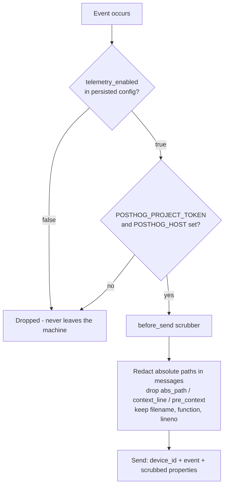

# ADR-0042: Telemetry Privacy Boundaries (Scrubbing, Opt-Out, Credential Loading)

> Status: **Accepted**
> Date: 2026-10-18
> Owner: @DIKKA

## Context

PostHog was integrated into the app by an external wizard, which produced a
generated report (`docs/PRODUCT_TELEMETRY.md`) rather than a design record. The
integration had grown several privacy boundaries that were implemented in code
but documented nowhere, and two real gaps.

**What was already sound.** MCP tool telemetry is funnelled through a single
allowlist (`capture_mcp_tool_call`), which drops `args`, `query`, `path`,
`content`, `text`, `project_label` and other path-bearing or free-form keys, and
forwards JSON scalars only. Reviewing the catalog surfaced one key that had
slipped through: `name`, the user-authored skill name sent by `sm_create_skill`.
It is the same kind of identifier as the already-blocked `skill_id`, so it is
now dropped by the same allowlist. Sentry is initialised with
`before_send=_scrub_sentry_event`, which strips `request`, `user` and breadcrumb
`data`. CI (`secret-guard`) fails the build if `.env` becomes tracked or a
`phc_…` token is committed. The device identity is a random `device_<uuid4>`,
never a machine or user identifier.

**Gap 1 — exception payloads bypassed every allowlist.** The client is created
with `enable_exception_autocapture=True`, which installs global `sys.excepthook`
and `threading.excepthook` handlers. Every uncaught exception, plus the ~19
explicit `capture_exception()` call sites, ships its message and stack trace
with no scrubbing. Those messages routinely embed absolute paths (e.g.
`core/skill_packages/updater.py` raises `f"...not an empty git checkout: {path}"`)
and the stack frames carry `abs_path`, `context_line`, `pre_context` and
`post_context` — source lines and directory trees, which embed the OS username.
Sentry was scrubbed; PostHog was not.

**Gap 2 — credentials were loaded from the current working directory.**
`core/analytics.py` called bare `load_dotenv()`, which searches upward from the
CWD. Verified experimentally: launching from a directory whose parent contained
a `.env` loaded that file wholesale into the process environment — including
unrelated secrets such as `PROJECT_DB_PASSWORD`, and any `POSTHOG_HOST`, which
could redirect this app's telemetry *and its project token* to an arbitrary
endpoint. This matters more than usual here because SkillManager is a tool whose
normal job is to run inside project directories.

**Gap 3 — no user control.** Telemetry was enabled whenever credentials were
present, and could only be disabled by finding and emptying an environment
variable. No Settings control existed, even though `docs/USER_GUIDE.md` claimed
"Telemetry stays opt-in and disabled by default".

## Decision

Telemetry follows four rules.

1. **One scrubbing seam for every outgoing event.** The PostHog client is
   constructed with `before_send=_scrub_posthog_event`, mirroring the existing
   Sentry scrubber. It redacts absolute POSIX/Windows/`~` paths in exception
   messages and deletes `abs_path`, `context_line`, `pre_context`,
   `post_context` and `vars` from every frame, keeping the bare filename,
   function and line number for debuggability. It must never raise: the SDK
   fails *open* on a `before_send` exception, so a crash there would ship the
   unscrubbed payload.
2. **Local variable values are off.** `capture_exception_code_variables=False`
   is passed explicitly. It is already the SDK default; pinning it means a
   future default flip cannot silently start shipping variable contents.
3. **Credentials are never read from the CWD.** `.env` is resolved from an
   explicit, app-owned candidate list, first hit wins: `$DATA_DIR/.env`
   (packaged/user install), then `<repo>/.env` (source checkout). The process
   environment always takes precedence over either file.
4. **The user can turn it off, and off means off.** A persisted
   `ui_state.telemetry_enabled` flag (default `true`) is exposed as a Settings
   toggle. It is read directly from the persisted config at init, so it holds
   from the very first event (`app_opened`) without depending on Qt or
   controller startup order, and toggling it tears the client down immediately
   rather than at next restart.

Credentials are deliberately **not** bundled into release builds: the
PyInstaller spec ships only `assets/` and `SkillManagerComponents/`. A packaged
user therefore has telemetry off unless they create `$DATA_DIR/.env`
themselves, which is what makes "opt-in and disabled by default" true.

## Consequences

### Positive

- Exception telemetry can no longer leak filesystem layout, the OS username, or
  source lines — the largest previous leak surface is closed.
- Launching the app from an arbitrary project directory can no longer import
  that project's secrets or redirect telemetry to a foreign host.
- Users have a real, immediate opt-out, and the docs' "opt-in" claim is now
  backed by a control rather than by an untracked file's absence.
- Debuggability is preserved: frame file/function/line survive scrubbing.

### Negative

- Stack traces are less useful for support: call-site directory context is gone,
  so a report like "`updater.py:72` failed" no longer says *which* checkout.
  Acceptable, since paths would be redacted anyway.
- Two independent scrubbers (Sentry, PostHog) must be kept in step by hand.
- `$DATA_DIR/.env` is now the only way for a packaged user to enable telemetry,
  which is undiscoverable without the docs — intentional friction.

### Neutral

- The `before_send` hook adds one Python call per outgoing event on the client's
  background thread; negligible against the network send.
- Failure of the scrubber itself fails open, matching the SDK's behaviour; the
  regression tests therefore exercise malformed payloads directly.

## Alternatives Considered

### Disable `enable_exception_autocapture` entirely

Rejected: uncaught exceptions in Qt slots and threads are exactly the failures
worth knowing about, and explicit `capture_exception()` calls carry the same
payload shape. Scrubbing solves the leak without losing the signal.

### Rely on `capture_mcp_tool_call`'s allowlist for exceptions too

Rejected: that allowlist governs *key* selection at MCP call sites. Exception
payloads are produced by the SDK's hooks, never pass a call site, and leak
through message text and frame metadata rather than keys.

### Keep bare `load_dotenv()` and document "don't run from a project dir"

Rejected: unenforceable, and the failure mode is silent credential import plus
telemetry redirection.

### Make the toggle default to off

Rejected for now: it would disable the maintainer's own configured telemetry and
contradict the actual gating condition, which is credential presence. The
default is therefore `true`, and the honest guarantee is "off unless credentials
are configured, and always user-overridable".

## References

- `src/skill_manager/core/analytics.py` — `_scrub_posthog_event`, `_env_file_candidates`, `set_enabled`
- `src/skill_manager/bootstrap.py` — `_scrub_sentry_event` (the pattern this mirrors)
- `tests/test_telemetry_privacy.py`, `tests/test_analytics.py` — regression guards
- `docs/ENVIRONMENT.md` — `.env` resolution order
- `docs/PRODUCT_TELEMETRY.md` — integration overview
- `.github/workflows/_lint.yml` — `secret-guard` job
